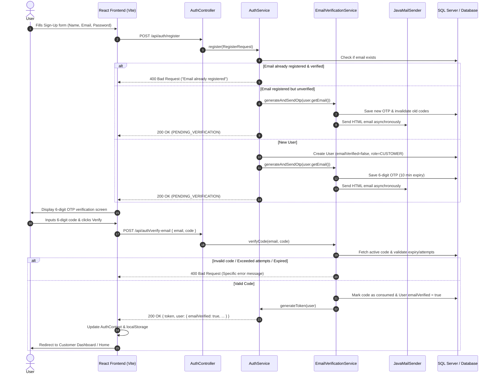

# RentEaseLanka — User Email Verification Implementation Plan

## 1. Executive Summary

This document outlines the end-to-end technical implementation plan for verifying user identity via email OTP (One-Time Password) codes during registration in the **RentEaseLanka** vehicle rental platform.

### 1.1 Objective
Ensure that every newly registered user proves ownership of their email address by submitting a time-sensitive 6-digit numeric verification code before gaining full access to the platform.

### 1.2 Scope & Separation of Verification Concerns
In RentEaseLanka, user verification involves two distinct layers:
1. **Email Identity Verification (`emailVerified: boolean`)**: Immediate automated proof of email ownership via 6-digit OTP code upon registration.
2. **KYC / NIC Document Verification (`verificationStatus: PENDING | VERIFIED | REJECTED`)**: Staff-driven inspection of National Identity Card (NIC) / Driving License images before booking approvals.

---

## 2. Architecture & Workflow

### 2.1 Complete Verification Sequence



---

## 3. Database Schema & Data Models

### 3.1 New Entity: `EmailVerificationCode`

Create table `email_verification_codes` to track active and historical verification codes with expiry and brute-force attempt tracking.

```text
Table: email_verification_codes
├── id               : BIGINT PRIMARY KEY IDENTITY(1,1)
├── email            : VARCHAR(255) NOT NULL (Indexed)
├── code_hash        : VARCHAR(255) NOT NULL (BCrypt hashed OTP or secure token)
├── expires_at       : DATETIME2 NOT NULL
├── created_at       : DATETIME2 NOT NULL
├── verified         : BIT NOT NULL DEFAULT 0
├── attempts_count   : INT NOT NULL DEFAULT 0
└── resend_cooldown  : DATETIME2 NOT NULL
```

#### Entity Class Implementation
**Path**: `RentEaseLankaTeam/src/main/java/com/RentEaseLanka/RentEaseLankaTeam/User_Management/Model/EmailVerificationCode.java`

```java
package com.RentEaseLanka.RentEaseLankaTeam.User_Management.Model;

import jakarta.persistence.*;
import lombok.*;
import java.time.LocalDateTime;

@Entity
@Table(name = "email_verification_codes", indexes = {
    @Index(name = "idx_verification_email", columnList = "email")
})
@Getter
@Setter
@NoArgsConstructor
@AllArgsConstructor
@Builder
public class EmailVerificationCode {

    @Id
    @GeneratedValue(strategy = GenerationType.IDENTITY)
    private Long id;

    @Column(nullable = false)
    private String email;

    @Column(nullable = false)
    private String codeHash;

    @Column(nullable = false)
    private LocalDateTime expiresAt;

    @Column(nullable = false)
    private LocalDateTime createdAt;

    @Column(nullable = false)
    private LocalDateTime resendAvailableAt;

    @Column(nullable = false)
    private boolean verified;

    @Column(nullable = false)
    private int attemptsCount;
}
```

---

### 3.2 Update Existing `User` Entity

**Path**: `RentEaseLankaTeam/src/main/java/com/RentEaseLanka/RentEaseLankaTeam/User_Management/Model/User.java`

Add the following fields:
```java
    @Column(nullable = false)
    @Builder.Default
    private boolean emailVerified = false;

    private LocalDateTime emailVerifiedAt;
```

---

## 4. Backend Design & Implementation

### 4.1 Required Maven Dependencies

Add `spring-boot-starter-mail` and `spring-boot-starter-thymeleaf` (or text template engine) in `RentEaseLankaTeam/pom.xml`:

```xml
<dependency>
    <groupId>org.springframework.boot</groupId>
    <artifactId>spring-boot-starter-mail</artifactId>
</dependency>
```

---

### 4.2 Configuration & Properties

Update `RentEaseLankaTeam/src/main/resources/application.properties`:

```properties
# ==========================================
# Email Verification & SMTP Configuration
# ==========================================
spring.mail.host=${SMTP_HOST:smtp.gmail.com}
spring.mail.port=${SMTP_PORT:587}
spring.mail.username=${SMTP_USERNAME}
spring.mail.password=${SMTP_PASSWORD}
spring.mail.properties.mail.smtp.auth=true
spring.mail.properties.mail.smtp.starttls.enable=true
spring.mail.properties.mail.smtp.starttls.required=true
spring.mail.properties.mail.smtp.connectiontimeout=5000
spring.mail.properties.mail.smtp.timeout=5000
spring.mail.properties.mail.smtp.writetimeout=5000

# Verification Parameters
app.email.verification.otp-length=6
app.email.verification.expiry-minutes=10
app.email.verification.max-attempts=5
app.email.verification.resend-cooldown-seconds=60
app.mail.from-address=${MAIL_FROM_ADDRESS:noreply@renteaselanka.com}
app.mail.from-name=RentEaseLanka Security
```

---

### 4.3 Data Transfer Objects (DTOs)

#### 1. `VerifyEmailRequest.java`
**Path**: `RentEaseLankaTeam/src/main/java/com/RentEaseLanka/RentEaseLankaTeam/User_Management/DTOs/VerifyEmailRequest.java`

```java
package com.RentEaseLanka.RentEaseLankaTeam.User_Management.DTOs;

import jakarta.validation.constraints.Email;
import jakarta.validation.constraints.NotBlank;
import jakarta.validation.constraints.Pattern;
import lombok.Data;

@Data
public class VerifyEmailRequest {
    @NotBlank(message = "Email is required")
    @Email(message = "Invalid email format")
    private String email;

    @NotBlank(message = "Verification code is required")
    @Pattern(regexp = "^[0-9]{6}$", message = "Verification code must be exactly 6 digits")
    private String code;
}
```

#### 2. `ResendCodeRequest.java`
**Path**: `RentEaseLankaTeam/src/main/java/com/RentEaseLanka/RentEaseLankaTeam/User_Management/DTOs/ResendCodeRequest.java`

```java
package com.RentEaseLanka.RentEaseLankaTeam.User_Management.DTOs;

import jakarta.validation.constraints.Email;
import jakarta.validation.constraints.NotBlank;
import lombok.Data;

@Data
public class ResendCodeRequest {
    @NotBlank(message = "Email is required")
    @Email(message = "Invalid email format")
    private String email;
}
```

#### 3. `RegistrationResponse.java`
**Path**: `RentEaseLankaTeam/src/main/java/com/RentEaseLanka/RentEaseLankaTeam/User_Management/DTOs/RegistrationResponse.java`

```java
package com.RentEaseLanka.RentEaseLankaTeam.User_Management.DTOs;

import lombok.AllArgsConstructor;
import lombok.Builder;
import lombok.Data;
import lombok.NoArgsConstructor;

@Data
@Builder
@NoArgsConstructor
@AllArgsConstructor
public class RegistrationResponse {
    private String status; // "PENDING_VERIFICATION" or "SUCCESS"
    private String message;
    private String email;
    private int cooldownSeconds;
}
```

---

### 4.4 Repository Layer

**Path**: `RentEaseLankaTeam/src/main/java/com/RentEaseLanka/RentEaseLankaTeam/User_Management/Repository/EmailVerificationCodeRepository.java`

```java
package com.RentEaseLanka.RentEaseLankaTeam.User_Management.Repository;

import com.RentEaseLanka.RentEaseLankaTeam.User_Management.Model.EmailVerificationCode;
import org.springframework.data.jpa.repository.JpaRepository;
import org.springframework.data.jpa.repository.Modifying;
import org.springframework.data.jpa.repository.Query;
import org.springframework.stereotype.Repository;

import java.time.LocalDateTime;
import java.util.Optional;

@Repository
public interface EmailVerificationCodeRepository extends JpaRepository<EmailVerificationCode, Long> {

    Optional<EmailVerificationCode> findTopByEmailAndVerifiedFalseOrderByCreatedAtDesc(String email);

    @Modifying
    @Query("DELETE FROM EmailVerificationCode e WHERE e.expiresAt < :now")
    void deleteExpiredCodes(LocalDateTime now);

    @Modifying
    @Query("UPDATE EmailVerificationCode e SET e.verified = true WHERE e.email = :email AND e.verified = false")
    void invalidatePreviousCodes(String email);
}
```

---

### 4.5 Email Sender Service

**Path**: `RentEaseLankaTeam/src/main/java/com/RentEaseLanka/RentEaseLankaTeam/User_Management/Service/EmailSenderService.java`

```java
package com.RentEaseLanka.RentEaseLankaTeam.User_Management.Service;

import jakarta.mail.MessagingException;
import jakarta.mail.internet.MimeMessage;
import lombok.RequiredArgsConstructor;
import lombok.extern.slf4j.Slf4j;
import org.springframework.beans.factory.annotation.Value;
import org.springframework.mail.javamail.JavaMailSender;
import org.springframework.mail.javamail.MimeMessageHelper;
import org.springframework.scheduling.annotation.Async;
import org.springframework.stereotype.Service;

@Service
@RequiredArgsConstructor
@Slf4j
public class EmailSenderService {

    private final JavaMailSender mailSender;

    @Value("${app.mail.from-address:noreply@renteaselanka.com}")
    private String fromAddress;

    @Value("${app.mail.from-name:RentEaseLanka}")
    private String fromName;

    @Async
    public void sendVerificationCodeEmail(String toEmail, String recipientName, String otpCode, int expiryMinutes) {
        try {
            MimeMessage mimeMessage = mailSender.createMimeMessage();
            MimeMessageHelper helper = new MimeMessageHelper(mimeMessage, "utf-8");

            helper.setFrom(fromAddress, fromName);
            helper.setTo(toEmail);
            helper.setSubject("RentEaseLanka — Verify Your Email Address");

            String htmlBody = buildVerificationEmailTemplate(recipientName, otpCode, expiryMinutes);
            helper.setText(htmlBody, true);

            mailSender.send(mimeMessage);
            log.info("Verification email sent successfully to: {}", toEmail);
        } catch (Exception e) {
            log.error("Failed to send verification email to: {}", toEmail, e);
            throw new RuntimeException("Could not send email verification code. Please try again.");
        }
    }

    private String buildVerificationEmailTemplate(String name, String code, int expiryMinutes) {
        return """
            <!DOCTYPE html>
            <html>
            <head>
                <meta charset="utf-8">
                <style>
                    body { font-family: 'Segoe UI', Tahoma, Geneva, Verdana, sans-serif; background-color: #f4f6f9; margin: 0; padding: 20px; }
                    .card { max-width: 520px; margin: 0 auto; background: #ffffff; border-radius: 12px; overflow: hidden; box-shadow: 0 4px 15px rgba(0,0,0,0.08); border: 1px solid #e5e9f0; }
                    .header { background: linear-gradient(135deg, #112c21 0%, #1d4533 100%); padding: 30px 20px; text-align: center; color: #ffffff; }
                    .header h1 { margin: 0; font-size: 24px; letter-spacing: 0.5px; color: #F9D2BA; }
                    .content { padding: 30px; color: #334155; line-height: 1.6; }
                    .code-badge { background: #f8fafc; border: 2px dashed #1d4533; border-radius: 8px; padding: 16px; text-align: center; font-size: 32px; font-weight: 700; letter-spacing: 8px; color: #112c21; margin: 24px 0; }
                    .footer { text-align: center; padding: 20px; font-size: 12px; color: #94a3b8; background: #f8fafc; border-top: 1px solid #e2e8f0; }
                </style>
            </head>
            <body>
                <div class="card">
                    <div class="header">
                        <h1>🚗 RentEaseLanka</h1>
                        <p style="margin: 5px 0 0; font-size: 14px; opacity: 0.85;">Account Verification</p>
                    </div>
                    <div class="content">
                        <p>Hello <strong>%s</strong>,</p>
                        <p>Thank you for registering with RentEaseLanka. Please use the following 6-digit verification code to complete your registration:</p>
                        <div class="code-badge">%s</div>
                        <p style="font-size: 13px; color: #64748b;">
                            ⏱️ This code is valid for <strong>%d minutes</strong>. For your security, never share this code with anyone.
                        </p>
                        <p>If you did not request this registration, please disregard this message.</p>
                    </div>
                    <div class="footer">
                        &copy; 2026 RentEaseLanka (Pvt) Ltd. All rights reserved.
                    </div>
                </div>
            </body>
            </html>
            """.formatted(name != null ? name : "Valued Customer", code, expiryMinutes);
    }
}
```

---

### 4.6 Verification Service

**Path**: `RentEaseLankaTeam/src/main/java/com/RentEaseLanka/RentEaseLankaTeam/User_Management/Service/EmailVerificationService.java`

```java
package com.RentEaseLanka.RentEaseLankaTeam.User_Management.Service;

import com.RentEaseLanka.RentEaseLankaTeam.User_Management.Model.EmailVerificationCode;
import com.RentEaseLanka.RentEaseLankaTeam.User_Management.Model.User;
import com.RentEaseLanka.RentEaseLankaTeam.User_Management.Repository.EmailVerificationCodeRepository;
import com.RentEaseLanka.RentEaseLankaTeam.User_Management.Repository.UserRepository;
import lombok.RequiredArgsConstructor;
import lombok.extern.slf4j.Slf4j;
import org.springframework.beans.factory.annotation.Value;
import org.springframework.security.crypto.password.PasswordEncoder;
import org.springframework.stereotype.Service;
import org.springframework.transaction.annotation.Transactional;

import java.security.SecureRandom;
import java.time.LocalDateTime;

@Service
@RequiredArgsConstructor
@Slf4j
public class EmailVerificationService {

    private final EmailVerificationCodeRepository codeRepository;
    private final UserRepository userRepository;
    private final EmailSenderService emailSenderService;
    private final PasswordEncoder passwordEncoder;

    @Value("${app.email.verification.expiry-minutes:10}")
    private int expiryMinutes;

    @Value("${app.email.verification.max-attempts:5}")
    private int maxAttempts;

    @Value("${app.email.verification.resend-cooldown-seconds:60}")
    private int cooldownSeconds;

    private final SecureRandom secureRandom = new SecureRandom();

    @Transactional
    public void generateAndSendVerificationCode(User user) {
        String email = user.getEmail();
        LocalDateTime now = LocalDateTime.now();

        // Check if an existing code is within cooldown
        var existingCodeOpt = codeRepository.findTopByEmailAndVerifiedFalseOrderByCreatedAtDesc(email);
        if (existingCodeOpt.isPresent()) {
            EmailVerificationCode existingCode = existingCodeOpt.get();
            if (now.isBefore(existingCode.getResendAvailableAt())) {
                long remainingSeconds = java.time.Duration.between(now, existingCode.getResendAvailableAt()).getSeconds();
                throw new IllegalStateException("Please wait " + remainingSeconds + " seconds before requesting a new code.");
            }
        }

        // Invalidate previous unverified codes
        codeRepository.invalidatePreviousCodes(email);

        // Generate 6-digit numeric OTP
        int rawCode = 100000 + secureRandom.nextInt(900000);
        String codeString = String.valueOf(rawCode);

        // Create entity
        EmailVerificationCode verificationCode = EmailVerificationCode.builder()
                .email(email)
                .codeHash(passwordEncoder.encode(codeString))
                .createdAt(now)
                .expiresAt(now.plusMinutes(expiryMinutes))
                .resendAvailableAt(now.plusSeconds(cooldownSeconds))
                .verified(false)
                .attemptsCount(0)
                .build();

        codeRepository.save(verificationCode);

        // Send email asynchronously
        emailSenderService.sendVerificationCodeEmail(
                user.getEmail(),
                user.getFirstName(),
                codeString,
                expiryMinutes
        );
    }

    @Transactional
    public User verifyCode(String email, String rawCode) {
        LocalDateTime now = LocalDateTime.now();

        EmailVerificationCode verificationCode = codeRepository
                .findTopByEmailAndVerifiedFalseOrderByCreatedAtDesc(email)
                .orElseThrow(() -> new IllegalArgumentException("No pending verification code found for this email."));

        // Check expiration
        if (now.isAfter(verificationCode.getExpiresAt())) {
            throw new IllegalArgumentException("Verification code has expired. Please request a new one.");
        }

        // Check maximum attempts
        if (verificationCode.getAttemptsCount() >= maxAttempts) {
            throw new IllegalArgumentException("Maximum verification attempts exceeded. Please request a new code.");
        }

        // Verify OTP match
        if (!passwordEncoder.matches(rawCode, verificationCode.getCodeHash())) {
            verificationCode.setAttemptsCount(verificationCode.getAttemptsCount() + 1);
            codeRepository.save(verificationCode);
            int remaining = maxAttempts - verificationCode.getAttemptsCount();
            throw new IllegalArgumentException("Invalid verification code. " + remaining + " attempts remaining.");
        }

        // Mark code as verified
        verificationCode.setVerified(true);
        codeRepository.save(verificationCode);

        // Update user state
        User user = userRepository.findByEmail(email)
                .orElseThrow(() -> new IllegalArgumentException("User not found"));

        user.setEmailVerified(true);
        user.setEmailVerifiedAt(now);
        return userRepository.save(user);
    }
}
```

---

### 4.7 Updating `AuthService`

**Path**: `RentEaseLankaTeam/src/main/java/com/RentEaseLanka/RentEaseLankaTeam/User_Management/Service/AuthService.java`

Update `register(...)` and `authenticate(...)` to integrate email verification:

```java
@Service
@RequiredArgsConstructor
public class AuthService {

    private final UserRepository repository;
    private final PasswordEncoder passwordEncoder;
    private final JwtService jwtService;
    private final AuthenticationManager authenticationManager;
    private final EmailVerificationService emailVerificationService;

    @Transactional
    public RegistrationResponse register(RegisterRequest request) {
        var existingUserOpt = repository.findByEmail(request.getEmail());

        if (existingUserOpt.isPresent()) {
            User existingUser = existingUserOpt.get();
            if (existingUser.isEmailVerified()) {
                throw new IllegalArgumentException("An account with this email already exists.");
            }
            // User exists but has not completed email verification: update details & resend OTP
            existingUser.setFirstName(request.getFirstName());
            existingUser.setLastName(request.getLastName());
            existingUser.setPassword(passwordEncoder.encode(request.getPassword()));
            repository.save(existingUser);

            emailVerificationService.generateAndSendVerificationCode(existingUser);
            return RegistrationResponse.builder()
                    .status("PENDING_VERIFICATION")
                    .message("Verification code resent to your email.")
                    .email(request.getEmail())
                    .cooldownSeconds(60)
                    .build();
        }

        var user = User.builder()
                .firstName(request.getFirstName())
                .lastName(request.getLastName())
                .email(request.getEmail())
                .password(passwordEncoder.encode(request.getPassword()))
                .role(Role.CUSTOMER)
                .verificationStatus(VerificationStatus.PENDING)
                .emailVerified(false)
                .build();

        repository.save(user);
        emailVerificationService.generateAndSendVerificationCode(user);

        return RegistrationResponse.builder()
                .status("PENDING_VERIFICATION")
                .message("Verification code sent to your email.")
                .email(request.getEmail())
                .cooldownSeconds(60)
                .build();
    }

    public AuthenticationResponse verifyEmail(VerifyEmailRequest request) {
        User verifiedUser = emailVerificationService.verifyCode(request.getEmail(), request.getCode());
        var jwtToken = jwtService.generateToken(verifiedUser);
        return AuthenticationResponse.builder()
                .token(jwtToken)
                .user(verifiedUser)
                .build();
    }

    public RegistrationResponse resendVerificationCode(ResendCodeRequest request) {
        User user = repository.findByEmail(request.getEmail())
                .orElseThrow(() -> new IllegalArgumentException("No account found with this email."));

        if (user.isEmailVerified()) {
            throw new IllegalArgumentException("This email address is already verified.");
        }

        emailVerificationService.generateAndSendVerificationCode(user);
        return RegistrationResponse.builder()
                .status("PENDING_VERIFICATION")
                .message("A new verification code has been sent.")
                .email(request.getEmail())
                .cooldownSeconds(60)
                .build();
    }

    public AuthenticationResponse authenticate(AuthenticationRequest request) {
        authenticationManager.authenticate(
                new UsernamePasswordAuthenticationToken(
                        request.getEmail(),
                        request.getPassword()
                )
        );
        var user = repository.findByEmail(request.getEmail())
                .orElseThrow(() -> new IllegalArgumentException("User not found"));

        if (!user.isEmailVerified()) {
            throw new IllegalStateException("EMAIL_NOT_VERIFIED");
        }

        var jwtToken = jwtService.generateToken(user);
        return AuthenticationResponse.builder()
                .token(jwtToken)
                .user(user)
                .build();
    }
}
```

---

### 4.8 Updating `AuthController` & `SecurityConfig`

**Path**: `RentEaseLankaTeam/src/main/java/com/RentEaseLanka/RentEaseLankaTeam/User_Management/Controller/AuthController.java`

```java
@RestController
@RequestMapping("/api/auth")
@RequiredArgsConstructor
public class AuthController {

    private final AuthService service;

    @PostMapping("/register")
    public ResponseEntity<RegistrationResponse> register(@Valid @RequestBody RegisterRequest request) {
        return ResponseEntity.ok(service.register(request));
    }

    @PostMapping("/verify-email")
    public ResponseEntity<AuthenticationResponse> verifyEmail(@Valid @RequestBody VerifyEmailRequest request) {
        return ResponseEntity.ok(service.verifyEmail(request));
    }

    @PostMapping("/resend-code")
    public ResponseEntity<RegistrationResponse> resendCode(@Valid @RequestBody ResendCodeRequest request) {
        return ResponseEntity.ok(service.resendVerificationCode(request));
    }

    @PostMapping("/login")
    public ResponseEntity<AuthenticationResponse> authenticate(@Valid @RequestBody AuthenticationRequest request) {
        return ResponseEntity.ok(service.authenticate(request));
    }
}
```

#### `SecurityConfig.java` Updates
Ensure `/api/auth/verify-email` and `/api/auth/resend-code` are permitted without JWT:

```java
.requestMatchers(
    "/api/auth/register", 
    "/api/auth/login", 
    "/api/auth/verify-email", 
    "/api/auth/resend-code"
).permitAll()
```

---

## 5. Frontend Design & Implementation

### 5.1 API Client Layer

**Path**: `frontend/src/api/auth.js`

Add endpoints for email verification:

```javascript
import API from './axiosInstance';

export const login = async (credentials) => {
  const response = await API.post('/auth/login', credentials);
  return response.data;
};

export const register = async (userData) => {
  const response = await API.post('/auth/register', userData);
  return response.data;
};

export const verifyEmail = async (payload) => {
  // payload: { email: string, code: string }
  const response = await API.post('/auth/verify-email', payload);
  return response.data;
};

export const resendVerificationCode = async (payload) => {
  // payload: { email: string }
  const response = await API.post('/auth/resend-code', payload);
  return response.data;
};
```

---

### 5.2 Standalone & Modal Verification Component

**Path**: `frontend/src/pages/Auth/EmailVerification.jsx`

#### Features:
- 6-slot individual input boxes with auto-focus shift on typing.
- Backspace navigation to previous box.
- Clipboard paste auto-distributes all 6 digits.
- 60-second countdown timer for code resend.
- Error shaking animation and status messages.
- Direct integration with `AuthContext.login` upon verification.

```jsx
import { useState, useRef, useEffect } from 'react';
import { useNavigate, useLocation, Link } from 'react-router-dom';
import { toast } from 'react-toastify';
import { FiMail, FiCheckCircle, FiRefreshCw, FiArrowLeft } from 'react-icons/fi';
import { verifyEmail, resendVerificationCode } from '../../api/auth';
import { useAuth } from '../../context/AuthContext';
import './Auth.css';

const OTP_LENGTH = 6;

const EmailVerification = ({ emailProp, onVerified, onBackToSignUp }) => {
  const navigate = useNavigate();
  const location = useLocation();
  const { login: authLogin } = useAuth();

  const email = emailProp || location.state?.email || '';
  const [otp, setOtp] = useState(new Array(OTP_LENGTH).fill(''));
  const [loading, setLoading] = useState(false);
  const [resending, setResending] = useState(false);
  const [cooldown, setCooldown] = useState(60);
  const [shake, setShake] = useState(false);
  const inputRefs = useRef([]);

  useEffect(() => {
    if (!email) {
      toast.warn('No email found. Please register first.');
      navigate('/signup');
    }
  }, [email, navigate]);

  useEffect(() => {
    if (cooldown <= 0) return;
    const timer = setInterval(() => {
      setCooldown((prev) => prev - 1);
    }, 1000);
    return () => clearInterval(timer);
  }, [cooldown]);

  const triggerShake = () => {
    setShake(true);
    setTimeout(() => setShake(false), 600);
  };

  const handleChange = (index, value) => {
    if (isNaN(value)) return;

    const newOtp = [...otp];
    newOtp[index] = value.substring(value.length - 1);
    setOtp(newOtp);

    // Auto focus next input
    if (value && index < OTP_LENGTH - 1) {
      inputRefs.current[index + 1]?.focus();
    }
  };

  const handleKeyDown = (index, e) => {
    if (e.key === 'Backspace' && !otp[index] && index > 0) {
      inputRefs.current[index - 1]?.focus();
    }
  };

  const handlePaste = (e) => {
    e.preventDefault();
    const pastedData = e.clipboardData.getData('text/plain').trim();
    if (!/^\d+$/.test(pastedData)) return;

    const digits = pastedData.slice(0, OTP_LENGTH).split('');
    const newOtp = [...otp];
    digits.forEach((d, i) => {
      newOtp[i] = d;
    });
    setOtp(newOtp);

    const focusIdx = Math.min(digits.length, OTP_LENGTH - 1);
    inputRefs.current[focusIdx]?.focus();
  };

  const handleVerify = async (e) => {
    e?.preventDefault();
    const code = otp.join('');
    if (code.length !== OTP_LENGTH) {
      toast.error('Please enter the complete 6-digit verification code.');
      triggerShake();
      return;
    }

    setLoading(true);
    try {
      const response = await verifyEmail({ email, code });
      toast.success('Email verified successfully! Welcome to RentEaseLanka.');

      if (response.token) {
        authLogin(response);
      }

      if (onVerified) {
        onVerified(response);
      } else {
        navigate('/');
      }
    } catch (error) {
      const msg = error.response?.data?.message || 'Invalid or expired verification code.';
      toast.error(msg);
      triggerShake();
    } finally {
      setLoading(false);
    }
  };

  const handleResend = async () => {
    if (cooldown > 0 || resending) return;
    setResending(true);
    try {
      await resendVerificationCode({ email });
      toast.success('A fresh verification code has been sent to your email.');
      setCooldown(60);
      setOtp(new Array(OTP_LENGTH).fill(''));
      inputRefs.current[0]?.focus();
    } catch (error) {
      const msg = error.response?.data?.message || 'Failed to resend code. Please try again.';
      toast.error(msg);
    } finally {
      setResending(false);
    }
  };

  return (
    <div className="auth-page">
      {/* Brand Side Panel */}
      <div className="auth-left">
        <div className="auth-orb auth-orb-1" />
        <div className="auth-orb auth-orb-2" />
        <div className="auth-brand">
          <div className="auth-brand-logo">
            <div className="auth-brand-icon">🛡️</div>
            <div>
              <div className="auth-brand-name">
                RentEaseLanka
                <span>Identity Verification</span>
              </div>
            </div>
          </div>
          <h2 className="auth-brand-headline">
            Security<br />
            <span>First Experience</span>
          </h2>
          <p className="auth-brand-sub">
            We ensure verified identities across all rentals for the safest road adventures in Sri Lanka.
          </p>
        </div>
      </div>

      {/* Verification Card */}
      <div className="auth-right">
        <div className="auth-form-wrapper">
          <div className="auth-form-header">
            <div className="verify-icon-bubble">
              <FiMail />
            </div>
            <h2>Verify Your Email</h2>
            <p>
              We've sent a 6-digit security code to<br />
              <strong className="highlight-email">{email}</strong>
            </p>
          </div>

          <form className={`auth-form${shake ? ' shake' : ''}`} onSubmit={handleVerify}>
            <div className="otp-container" onPaste={handlePaste}>
              {otp.map((digit, idx) => (
                <input
                  key={idx}
                  ref={(el) => (inputRefs.current[idx] = el)}
                  type="text"
                  maxLength="1"
                  inputMode="numeric"
                  pattern="[0-9]*"
                  className={`otp-digit-box ${digit ? 'filled' : ''}`}
                  value={digit}
                  onChange={(e) => handleChange(idx, e.target.value)}
                  onKeyDown={(e) => handleKeyDown(idx, e)}
                  autoFocus={idx === 0}
                  required
                />
              ))}
            </div>

            <button
              type="submit"
              className="auth-btn verify-submit-btn"
              disabled={loading || otp.join('').length !== OTP_LENGTH}
            >
              {loading ? <div className="spinner" /> : <><FiCheckCircle /> Verify & Continue</>}
            </button>
          </form>

          <div className="otp-resend-section">
            {cooldown > 0 ? (
              <span className="cooldown-text">
                Resend code in <strong>00:{cooldown < 10 ? `0${cooldown}` : cooldown}</strong>
              </span>
            ) : (
              <button
                type="button"
                className="resend-btn"
                onClick={handleResend}
                disabled={resending}
              >
                <FiRefreshCw className={resending ? 'spin' : ''} /> Resend Code
              </button>
            )}
          </div>

          <div className="auth-form-footer">
            {onBackToSignUp ? (
              <button type="button" className="link-button" onClick={onBackToSignUp}>
                <FiArrowLeft /> Back to Registration
              </button>
            ) : (
              <p>Wrong email? <Link to="/signup">Register with another email</Link></p>
            )}
          </div>
        </div>
      </div>
    </div>
  );
};

export default EmailVerification;
```

---

### 5.3 Integrated Multi-Step `SignUp.jsx`

Upgrade `SignUp.jsx` to smoothly switch between **Step 1 (Form Details)** and **Step 2 (Email Code Verification)** without losing user context:

```jsx
import { useState } from 'react';
import { Link, useNavigate } from 'react-router-dom';
import { toast } from 'react-toastify';
import { FiMail, FiLock, FiUser } from 'react-icons/fi';
import { register } from '../../api/auth';
import EmailVerification from './EmailVerification';
import './Auth.css';

const SignUp = () => {
  const navigate = useNavigate();
  const [loading, setLoading] = useState(false);
  const [shake, setShake] = useState(false);
  const [step, setStep] = useState('REGISTER'); // 'REGISTER' | 'VERIFY'
  const [registeredEmail, setRegisteredEmail] = useState('');

  const [formData, setFormData] = useState({
    firstName: '',
    lastName: '',
    email: '',
    password: '',
    confirmPassword: '',
  });

  const handleChange = (e) => {
    const { name, value } = e.target;
    setFormData((prev) => ({ ...prev, [name]: value }));
  };

  const triggerShake = () => {
    setShake(true);
    setTimeout(() => setShake(false), 600);
  };

  const handleSubmit = async (e) => {
    e.preventDefault();

    if (formData.password !== formData.confirmPassword) {
      toast.error('Passwords do not match');
      triggerShake();
      return;
    }

    setLoading(true);

    try {
      const payload = {
        firstName: formData.firstName,
        lastName: formData.lastName,
        email: formData.email,
        password: formData.password,
      };

      const response = await register(payload);
      setRegisteredEmail(formData.email);
      toast.success(response.message || 'Verification code sent to your email!');
      setStep('VERIFY');
    } catch (error) {
      const errorMsg = error.response?.data?.message || 'Failed to register. Please try again.';
      toast.error(errorMsg);
      triggerShake();
    } finally {
      setLoading(false);
    }
  };

  if (step === 'VERIFY') {
    return (
      <EmailVerification
        emailProp={registeredEmail}
        onVerified={() => navigate('/')}
        onBackToSignUp={() => setStep('REGISTER')}
      />
    );
  }

  return (
    <div className="auth-page">
      {/* Existing Brand Panel */}
      <div className="auth-left">
        <div className="auth-orb auth-orb-1" />
        <div className="auth-orb auth-orb-2" />
        <div className="auth-brand">
          <div className="auth-brand-logo">
            <div className="auth-brand-icon">🚗</div>
            <div>
              <div className="auth-brand-name">
                RentEaseLanka
                <span>Premium Vehicle Rental</span>
              </div>
            </div>
          </div>
          <h2 className="auth-brand-headline">
            Join Sri Lanka's<br />
            <span>Premier Fleet</span>
          </h2>
          <p className="auth-brand-sub">
            Create your account and verify your email to unlock instant vehicle bookings island-wide.
          </p>
        </div>
      </div>

      {/* Form Panel */}
      <div className="auth-right">
        <div className="auth-form-wrapper">
          <div className="auth-form-header">
            <h2>Create Account</h2>
            <p>Join thousands of travellers exploring Sri Lanka.</p>
          </div>

          <form className={`auth-form${shake ? ' shake' : ''}`} onSubmit={handleSubmit} id="signup-form">
            <div className="auth-name-row">
              <div className="form-group">
                <label htmlFor="firstName">First Name</label>
                <div className="form-input-wrapper">
                  <FiUser className="form-input-icon" />
                  <input
                    type="text"
                    id="firstName"
                    name="firstName"
                    placeholder="John"
                    value={formData.firstName}
                    onChange={handleChange}
                    required
                  />
                </div>
              </div>
              <div className="form-group">
                <label htmlFor="lastName">Last Name</label>
                <div className="form-input-wrapper">
                  <FiUser className="form-input-icon" />
                  <input
                    type="text"
                    id="lastName"
                    name="lastName"
                    placeholder="Doe"
                    value={formData.lastName}
                    onChange={handleChange}
                    required
                  />
                </div>
              </div>
            </div>

            <div className="form-group">
              <label htmlFor="email">Email Address</label>
              <div className="form-input-wrapper">
                <FiMail className="form-input-icon" />
                <input
                  type="email"
                  id="email"
                  name="email"
                  placeholder="you@example.com"
                  value={formData.email}
                  onChange={handleChange}
                  required
                />
              </div>
            </div>

            <div className="form-group">
              <label htmlFor="password">Password</label>
              <div className="form-input-wrapper">
                <FiLock className="form-input-icon" />
                <input
                  type="password"
                  id="password"
                  name="password"
                  placeholder="Create a strong password"
                  value={formData.password}
                  onChange={handleChange}
                  required
                />
              </div>
            </div>

            <div className="form-group">
              <label htmlFor="confirmPassword">Confirm Password</label>
              <div className="form-input-wrapper">
                <FiLock className="form-input-icon" />
                <input
                  type="password"
                  id="confirmPassword"
                  name="confirmPassword"
                  placeholder="Repeat your password"
                  value={formData.confirmPassword}
                  onChange={handleChange}
                  required
                />
              </div>
            </div>

            <button type="submit" className="auth-btn" disabled={loading} id="signup-submit-btn">
              {loading ? <div className="spinner" /> : 'Continue to Verification'}
            </button>
          </form>

          <div className="auth-form-footer">
            <p>Already have an account? <Link to="/signin">Sign In</Link></p>
          </div>
        </div>
      </div>
    </div>
  );
};

export default SignUp;
```

---

### 5.4 Updating `SignIn.jsx` for Unverified Email Interception

Catch `EMAIL_NOT_VERIFIED` exception when unverified users attempt to log in, and seamlessly route them to verification:

```javascript
try {
  const data = await login(formData);
  // normal signin navigation...
} catch (error) {
  const errorMsg = error.response?.data?.message || '';
  if (errorMsg.includes('EMAIL_NOT_VERIFIED')) {
    toast.info('Please verify your email address to complete your account activation.');
    navigate('/verify-email', { state: { email: formData.email } });
    return;
  }
  toast.error(errorMsg || 'Failed to sign in. Please check your credentials.');
  triggerShake();
}
```

---

### 5.5 App Routing Updates

**Path**: `frontend/src/App.jsx`

Add the standalone `/verify-email` route:

```jsx
import EmailVerification from './pages/Auth/EmailVerification';

// inside <Routes>
<Route path="/signin" element={<SignIn />} />
<Route path="/signup" element={<SignUp />} />
<Route path="/verify-email" element={<EmailVerification />} />
```

---

### 5.6 CSS Styling for OTP Input

Add to `frontend/src/pages/Auth/Auth.css`:

```css
/* ===== EMAIL VERIFICATION STYLES ===== */
.verify-icon-bubble {
  width: 68px;
  height: 68px;
  background: rgba(29, 69, 51, 0.1);
  color: var(--color-primary, #1d4533);
  border-radius: 50%;
  display: flex;
  align-items: center;
  justify-content: center;
  font-size: 2rem;
  margin: 0 auto 16px;
  border: 2px solid rgba(29, 69, 51, 0.2);
}

.highlight-email {
  color: var(--color-primary, #1d4533);
  font-weight: 600;
  display: inline-block;
  margin-top: 4px;
}

.otp-container {
  display: flex;
  gap: 12px;
  justify-content: center;
  margin: 28px 0 20px;
}

.otp-digit-box {
  width: 52px;
  height: 62px;
  border: 2px solid var(--border-color, #e2e8f0);
  background: var(--bg-card, #ffffff);
  border-radius: 12px;
  text-align: center;
  font-size: 1.75rem;
  font-weight: 700;
  color: var(--text-primary, #0f172a);
  transition: all 0.2s ease;
  box-shadow: 0 2px 4px rgba(0, 0, 0, 0.02);
}

.otp-digit-box:focus {
  outline: none;
  border-color: var(--color-primary, #1d4533);
  box-shadow: 0 0 0 4px rgba(29, 69, 51, 0.15);
  transform: translateY(-2px);
}

.otp-digit-box.filled {
  border-color: #1d4533;
  background: rgba(29, 69, 51, 0.03);
}

.verify-submit-btn {
  display: flex;
  align-items: center;
  justify-content: center;
  gap: 8px;
  margin-top: 10px;
}

.otp-resend-section {
  text-align: center;
  margin-top: 20px;
  font-size: 0.95rem;
}

.cooldown-text {
  color: #64748b;
}

.cooldown-text strong {
  color: var(--color-primary, #1d4533);
}

.resend-btn {
  background: none;
  border: none;
  color: var(--color-primary, #1d4533);
  font-weight: 600;
  cursor: pointer;
  display: inline-flex;
  align-items: center;
  gap: 6px;
  transition: color 0.2s ease;
}

.resend-btn:hover:not(:disabled) {
  text-decoration: underline;
}

.spin {
  animation: spin 1s linear infinite;
}

@keyframes spin {
  100% { transform: rotate(360deg); }
}
```

---

## 6. Security, Rate Limiting & Edge Case Handling

| Risk / Edge Case | Mitigation Strategy |
| :--- | :--- |
| **Brute Force OTP Guessing** | Max 5 failed attempts per OTP code. The code is invalidated immediately once 5 attempts fail. |
| **OTP Code Storage in DB** | Raw OTP codes are hashed using `BCryptPasswordEncoder` prior to storage. |
| **Code Expiration** | 10-minute maximum validity period. Expired codes are rejected with explicit message. |
| **Email Bombing / Spamming** | 60-second cooldown enforced on both frontend countdown and backend timestamps (`resendAvailableAt`). |
| **Asynchronous Sending** | Mail dispatching uses `@Async` executor to prevent blocking user HTTP request threads. |
| **Expired Code Cleanup** | Scheduled Spring task `@Scheduled(cron = "0 0 3 * * *")` to purge expired verification entries. |
| **Concurrent Registrations** | Safe atomic transaction updates on `UserRepository` and unique constraint on email. |

---

## 7. Step-by-Step Implementation Roadmap

### Phase 1: Dependencies & Configurations
1. Add `spring-boot-starter-mail` to `RentEaseLankaTeam/pom.xml`.
2. Configure SMTP credentials and application properties in `application.properties` and `.env`.

### Phase 2: Database & Backend Core
1. Create `EmailVerificationCode` entity and repository.
2. Update `User` entity with `emailVerified` and `emailVerifiedAt`.
3. Create `EmailSenderService` with HTML email template.
4. Implement `EmailVerificationService` with OTP generation, hashing, validation, and attempt counting.

### Phase 3: Auth Layer & Endpoints
1. Update `AuthService` to trigger OTP generation on registration.
2. Add `/verify-email` and `/resend-code` endpoints in `AuthController`.
3. Whitelist endpoints in `SecurityConfig.java`.
4. Update `authenticate` method to block unverified email logins.

### Phase 4: Frontend API & Components
1. Add API methods in `frontend/src/api/auth.js`.
2. Implement `EmailVerification.jsx` with 6-box pin input, auto-focus, paste handler, and cooldown timer.
3. Integrate multi-step flow in `SignUp.jsx`.
4. Update `SignIn.jsx` to redirect unverified users to `/verify-email`.
5. Add route `/verify-email` in `App.jsx` and styling in `Auth.css`.

### Phase 5: Verification & Quality Assurance
1. Test end-to-end registration with valid email.
2. Test wrong code submission (counter decrement).
3. Test expired code submission.
4. Test resend cooldown timer and email delivery.
5. Test login prevention for unverified users.

---

## 8. Verification & Test Plan

```text
[ ] 1. User signs up with valid details -> Receives 6-digit code via email.
[ ] 2. User enters valid code -> Account activated, JWT issued, redirected to home.
[ ] 3. User enters wrong code -> Shows "Invalid code, 4 attempts remaining".
[ ] 4. User exceeds 5 attempts -> Code invalidated, user prompted to request a new code.
[ ] 5. User clicks "Resend Code" before 60s -> Button is disabled with countdown timer.
[ ] 6. User clicks "Resend Code" after 60s -> Fresh code generated and delivered.
[ ] 7. Unverified user attempts login -> Blocked with notification and redirected to verification.
```
