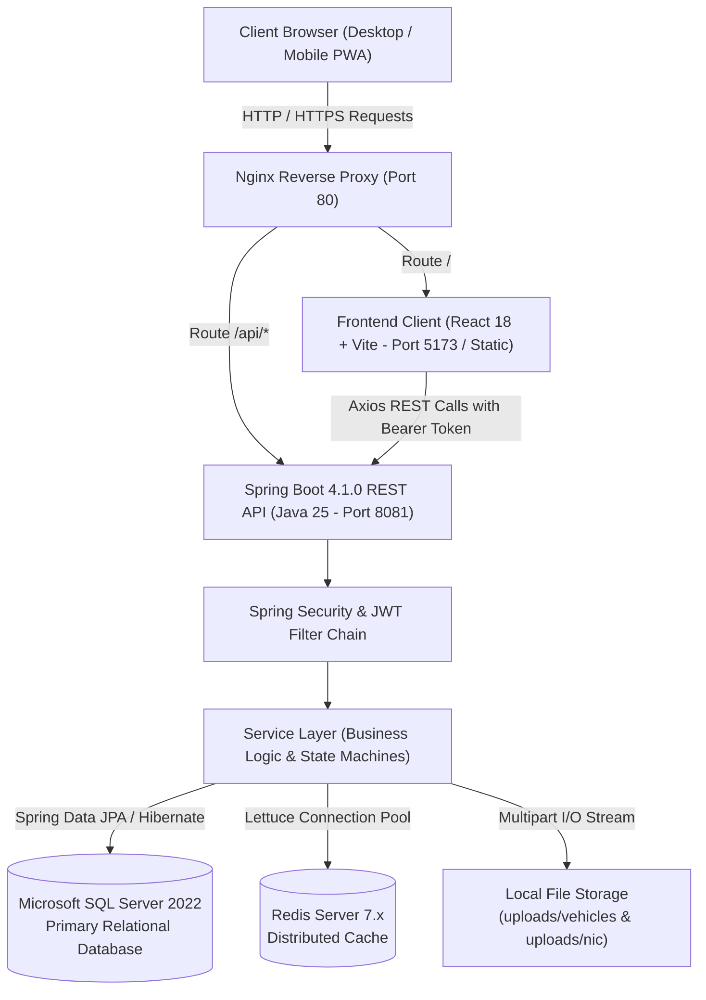
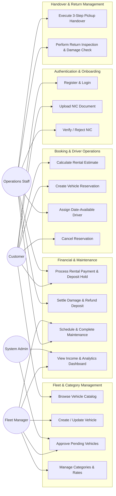
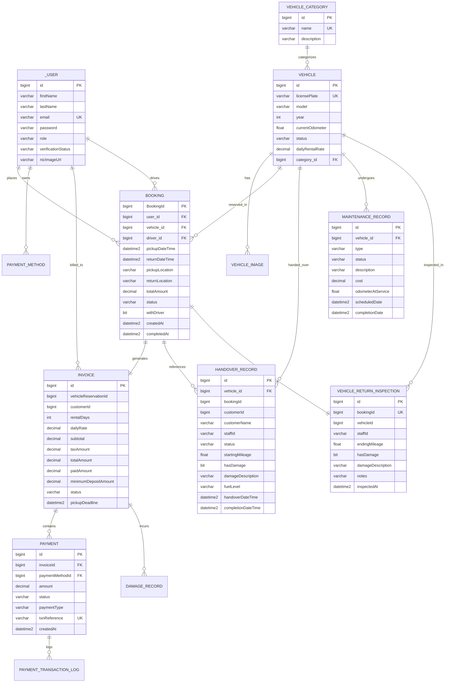
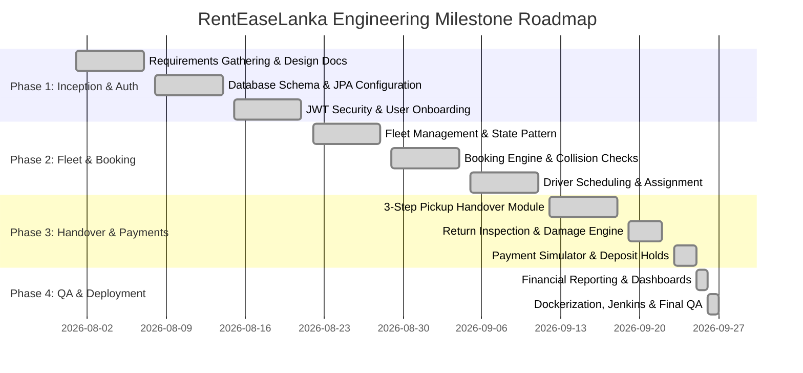

# 🚗 RentEaseLanka — Enterprise Vehicle Rental Management Platform

---

# SECTION 1: COVER PAGE

<div align="center">

# **SLIIT — SRI LANKA INSTITUTE OF INFORMATION TECHNOLOGY**
### **Faculty of Computing | Department of Software Engineering**

<br/>

## 📄 **COMPREHENSIVE SOFTWARE ENGINEERING PROJECT REPORT**
### **Project Title:** RentEaseLanka — Enterprise Full-Stack Vehicle Rental & Fleet Lifecycle Management Platform

<br/>

**Module Name:** Software Engineering  
**Module Code:** SE2030  
**Academic Year & Semester:** Year 2, Semester 1  
**Submission Date:** September 27, 2026  

<br/>

### **Group Members & Contribution Registry**

| # | Student ID | Student Full Name | Module / Domain Responsibility | Contribution (%) |
|---|---|---|---|---|
| **1** | *[Student ID 1]* | *[Student Full Name 1]* | **Admin_Dashboard** — Executive metrics dashboard, fleet & maintenance reporting, vehicle performance analytics, and dynamic system notifications | 100% |
| **2** | *[Student ID 2]* | *[Student Full Name 2]* | **BookingManagement** — Booking reservation engine, lifecycle state machine, price calculation algorithms, temporal overlap collision validation, and chauffeur scheduling | 100% |
| **3** | *[Student ID 3]* | *[Student Full Name 3]* | **User Management** — User registration, stateless JWT authentication, role-based access control (RBAC), and customer NIC/KYC document verification queue | 100% |
| **4** | *[Student ID 4]* | *[Student Full Name 4]* | **FleetAndMaintenenceManagement** — Fleet inventory management, GoF State Pattern lifecycle (`VehicleState`), vehicle category engine, and maintenance task scheduler | 100% |
| **5** | *[Student ID 5]* | *[Student Full Name 5]* | **Handover_adnReturn Management** — 3-step pickup handover workflow, starting odometer validation, vehicle return inspection desk, and post-rental damage assessments | 100% |
| **6** | *[Student ID 6]* | *[Student Full Name 6]* | **Payment_management** — Idempotent payment simulator, invoice generation, pre-authorized security deposit holds, damage deduction capture, automated deposit refunds & audit ledgers | 100% |

<br/>

---

### **Repository & Artifact Links**
- **GitHub Repository:** [https://github.com/IT25100066/RentEaseLankaDemo](https://github.com/IT25100066/RentEaseLankaDemo)
- **DockerHub Images:** `it25100066/renteaselanka-backend`, `it25100066/renteaselanka-frontend`
- **Application Architecture:** Spring Boot 4.1.0 (Java 21/25) • React 18.3 + Vite • MS SQL Server 2022 • Redis Cache • Nginx Reverse Proxy • Docker Compose

</div>

---

# SECTION 2: INTRODUCTION

## 2.1 Project Overview
The automotive rental industry in Sri Lanka has historically operated on fragmented, manual, and paper-based processes. Traditional rental agencies frequently face operational bottlenecks, including unauthorized vehicle dispatching, unverified customer onboarding, inaccurate manual mileage tracking, unrecorded vehicle damages at return, uncollected security deposits, driver scheduling conflicts, and opaque revenue reconciliation.

**RentEaseLanka** is an enterprise-grade, full-stack vehicle rental and fleet lifecycle management platform engineered to automate and govern the end-to-end lifecycle of car rental operations. Built upon modern software engineering principles, the system implements a strict multi-tier architecture powered by **Spring Boot 4.1 (Java 21/25)** on the backend, **React 18 with Vite** on the frontend, **Microsoft SQL Server 2022** as the primary relational database, **Redis** for distributed caching, and **Docker/Nginx** for containerized reverse-proxy orchestration.

The platform provides a single source of truth for all business operations: from public fleet exploration, customer National Identity Card (NIC) verification, and collision-free booking reservations to digital 3-step pickup handovers, pre-authorized security deposit holds, post-rental return damage inspections, automated maintenance tracking, and real-time financial income analytics.

## 2.2 Objectives
The primary objectives of the RentEaseLanka project are:
1. **Automate the End-to-End Rental Lifecycle:** Eliminate paper records by digitizing customer registration, fleet inventory management, reservation booking, vehicle dispatch, vehicle return, and financial invoicing into a unified digital workflow.
2. **Enforce State-Driven Business Integrity:** Implement finite state machines across Vehicles, Bookings, Handovers, and Maintenance to guarantee that no vehicle can be rented without physical inspection and no booking can be closed without invoice settlement and deposit release.
3. **Establish Rigorous Customer Verification:** Protect high-value fleet assets by enforcing mandatory National Identity Card (NIC) document uploads and staff verification before customer reservation privileges are unlocked.
4. **Implement Financial Security & Deposit Holds:** Provide a payment simulation engine that supports rental fee payments, pre-authorized security deposit holds, damage deduction settlements, and automated refund processing with full idempotency and audit logs.
5. **Eliminate Resource Conflicts:** Implement custom JPQL temporal collision detection algorithms to prevent overlapping reservations for vehicles and assignable drivers across overlapping date-time ranges.
6. **Deliver Role-Specific Dashboards:** Provide tailored user interfaces for Customers, Operations Staff, Fleet Managers, Chauffeur Drivers, and System Administrators.

## 2.3 Target Users & Stakeholders

| Stakeholder Role | Description & System Interaction Scope |
|---|---|
| **Customer** | Registered end-users who browse vehicle catalogs, calculate dynamic estimates with driver fees, submit reservation requests, upload identification documents (NIC), make payments, and monitor personal booking history. |
| **Operations Staff** | Operational personnel responsible for reviewing and verifying customer NIC uploads, conducting 3-step physical vehicle pickup handovers (mileage & pre-existing damage), assigning available drivers, executing vehicle return inspections, and initiating deposit releases. |
| **Fleet Manager** | Business managers who oversee vehicle inventory, upload multi-image vehicle assets, configure category base rates, batch-approve newly registered vehicles, schedule maintenance tasks, and provision staff/driver accounts. |
| **Chauffeur Driver** | Professional drivers provisioned by managers whose availability is dynamically scheduled and assigned to bookings requiring chauffeur assistance without schedule overlap. |
| **System Administrator** | Platform super-users with full administrative oversight, manager provisioning rights, system configuration audit controls, and real-time executive dashboard reporting. |
| **Fleet Owners / Executive Board** | Strategic business stakeholders who utilize the financial income reporting engine (gross revenue, maintenance expenses, net income) to make capital allocation decisions. |

## 2.4 Scope and Limitations

### In-Scope Capabilities
- **Role-Based Access Control (RBAC):** Stateless JWT-based authentication with 5 distinct roles (`CUSTOMER`, `STAFF`, `MANAGER`, `DRIVER`, `ADMIN`) and method-level `@PreAuthorize` security.
- **Customer Onboarding & NIC Verification:** Secure image upload, staff verification queue, and automated booking permission guards.
- **Fleet Inventory & Category Management:** Multi-part vehicle image uploads, category hierarchies, base daily rental fees, and State Pattern lifecycle transitions (`PENDING`, `AVAILABLE`, `RESERVED`, `RENTED`, `UNDER_MAINTENANCE`, `OUT_OF_SERVICE`).
- **Dynamic Booking Engine:** Date-range pricing, minimum 1-day rental enforcement, optional chauffeur fee calculations (3,000 LKR/day), and temporal overlap collision guards.
- **Driver Dispatch Module:** Manager-only driver creation, temporal overlap detection JPQL queries, and booking assignment controls.
- **3-Step Vehicle Pickup Handover:** Mandatory single authority for vehicle key release; records starting odometer, fuel level, and pre-existing physical damage.
- **Comprehensive Payment & Security Deposit Engine:** Invoice auto-generation, payment processing, pre-authorization security deposit holds, damage deduction capture, automated deposit refunds, and no-show invoice cleanup.
- **Vehicle Return & Post-Rental Inspection:** Odometer reconciliation, post-rental damage assessment with cost estimation, automated deposit settlement, and final booking completion gates.
- **Fleet Maintenance Tracking:** Scheduling, status tracking (`SCHEDULED`, `IN_PROGRESS`, `COMPLETED`, `CANCELLED`), vehicle status locking, cost accumulation, and service history logs.
- **Financial Analytics & Admin Reporting:** Date-range income analytics (gross revenue minus maintenance cost equals net revenue), fleet utilization percentages, and critical system alerts.

### Out-of-Scope & System Limitations
- **Live Vehicle Telematics / GPS Tracking:** Real-time GPS tracking hardware integration and IoT speed/geofencing telemetry are not implemented in this phase.
- **External Payment Gateways:** Real banking/credit-card APIs (e.g., Stripe, PayHere) are abstracted via an internal, idempotent **Payment Simulator Engine** for academic testing and controlled demonstration.
- **External SMS / WhatsApp Gateways:** Notifications are currently delivered via interactive in-app toast alerts and dashboard state badges rather than SMS/email telecommunication services.
- **Native Mobile Applications:** The system provides a responsive Progressive Web Application (PWA) compatible with mobile viewports, but native iOS/Android binary builds are out of scope.

---

# SECTION 3: REQUIREMENTS SPECIFICATION

## 3.1 Functional Requirements

```
                               FUNCTIONAL MODULE BREAKDOWN
 ┌─────────────────┬─────────────────┬─────────────────┬─────────────────┬─────────────────┐
 │ User Management │ Fleet Inventory │ Booking Engine  │ Handover/Return │ Payment & Fin.  │
 │  & RBAC (FR-1)  │  & State (FR-2) │  & Driver(FR-3) │ Lifecycles(FR-4)│ Analytics(FR-5) │
 └─────────────────┴─────────────────┴─────────────────┴─────────────────┴─────────────────┘
```

### Module 1: User Identity & Verification Management (FR-1)
- **FR-1.1:** The system shall allow new customers to self-register with first name, last name, email, and password (hashed via BCrypt).
- **FR-1.2:** The system shall authenticate users via email and password, issuing a signed, stateless JSON Web Token (JWT) containing user ID, role, and verification status.
- **FR-1.3:** The system shall allow authenticated customers to upload scanned images of their National Identity Card (NIC).
- **FR-1.4:** The system shall provide an operational queue for Staff/Managers/Admins to inspect uploaded NIC documents and transition customer status to `VERIFIED` or `REJECTED`.
- **FR-1.5:** The system shall strictly prevent unverified customers from creating vehicle reservations.
- **FR-1.6:** The system shall enforce hierarchical user creation: Administrators provision Managers; Managers provision Staff and Chauffeur Drivers.

### Module 2: Fleet & Vehicle Inventory Management (FR-2)
- **FR-2.1:** The system shall allow Fleet Managers to create vehicle records with model, manufacture year, registration plate, initial odometer, daily rental rate, category ID, and multi-part image uploads.
- **FR-2.2:** Newly registered vehicles shall default to the `PENDING` state and require Manager/Admin approval before transitioning to `AVAILABLE`.
- **FR-2.3:** The system shall implement the **State Design Pattern** to enforce valid vehicle transitions across `PENDING`, `AVAILABLE`, `RESERVED`, `RENTED`, `UNDER_MAINTENANCE`, and `OUT_OF_SERVICE`.
- **FR-2.4:** The system shall provide vehicle category management allowing managers to define categories (Sedan, SUV, Luxury, Van, etc.) and base rates.
- **FR-2.5:** The system shall allow public exploration and multi-criteria filtering of available vehicles by category, price, and status without authentication.

### Module 3: Booking & Driver Management (FR-3)
- **FR-3.1:** The system shall provide a public price calculation endpoint computing total cost based on rental days (minimum 1 day) and optional chauffeur service (3,000 LKR/day).
- **FR-3.2:** The system shall allow verified customers to create booking reservations, automatically validating date validity (pickup < return, dates in future) and reserving the vehicle (`RESERVED`).
- **FR-3.3:** The system shall prevent overlapping bookings for the same vehicle using database temporal interval checks.
- **FR-3.4:** The system shall allow staff to query available drivers for a specific date-time interval and assign an eligible driver to bookings with `withDriver = true`.
- **FR-3.5:** The system shall automatically generate an associated `UNPAID` invoice upon booking creation with an automated 2-hour pickup deadline.

### Module 4: Vehicle Pickup Handover & Return Inspection (FR-4)
- **FR-4.1:** The system shall mandate a 3-step pickup handover workflow (`PENDING` → `IN_PROGRESS` → `COMPLETED`) before any vehicle can be released.
- **FR-4.2:** Handover step 2 shall record starting odometer mileage, strictly validating that starting mileage is greater than or equal to the vehicle's current odometer.
- **FR-4.3:** Handover step 3 shall record pre-existing damage notes, fuel level, and staff authorization.
- **FR-4.4:** Handover completion shall atomically transition the vehicle to `RENTED` and the booking to `ACTIVE`.
- **FR-4.5:** The system shall provide a dedicated Return Inspection workflow upon vehicle return, capturing ending odometer, post-rental damage confirmation, and estimated repair costs.
- **FR-4.6:** The system shall prevent booking completion until return inspection is recorded, rental invoice is fully paid, and security deposit holds are resolved.

### Module 5: Payment, Security Deposits & Financial Analytics (FR-5)
- **FR-5.1:** The system shall process rental fee payments via an idempotent payment simulator, logging every event in `payment_transaction_logs`.
- **FR-5.2:** The system shall place pre-authorized security deposit holds against customer payment methods prior to handover completion.
- **FR-5.3:** Upon return inspection, the system shall automatically deduct approved damage repair costs from the security deposit and refund the remaining balance.
- **FR-5.4:** The system shall provide an automated no-show background cron processor that cancels overdue unpaid bookings and releases reserved vehicles.
- **FR-5.5:** The system shall generate income analytics for specified date ranges, calculating Gross Revenue, Maintenance Expenses, Net Income, and Fleet Utilization Rates.

---

## 3.2 Non-Functional Requirements (NFR)

| NFR Category | Metric / Specification | Technical Implementation in RentEaseLanka |
|---|---|---|
| **Security** | OWASP Top 10 Compliance, Stateless Auth, Strong Hashing | Stateless JWT token authentication (HMAC-SHA256), BCrypt password hashing (10 rounds), method-level `@PreAuthorize` guards, path traversal sanitization on uploaded files. |
| **Performance** | Sub-200ms API latency, fast read throughput | Redis distributed caching for vehicle catalog and category queries, indexed relational foreign keys in MS SQL Server, MapStruct compile-time DTO mappers. |
| **Data Integrity** | ACID transactions & strict state transitions | Spring `@Transactional` boundaries on all multi-entity operations (Handover, Return, Payment), database unique constraints on license plates, emails, and transaction references. |
| **Scalability** | Horizontal containerized scaling | Stateless Spring Boot backend architecture, containerized Docker Compose micro-services, Nginx reverse proxy load balancing capability. |
| **Usability & UX** | High responsiveness, zero layout shift, accessibility | React 18 SPA with custom Deep Forest Green & Peach design system, glassmorphism cards, responsive viewport grids, real-time React Toastify alerts, and modal wizards. |
| **Maintainability** | Clean Architecture, Low Coupling, High Cohesion | Layered architecture (Controller-Service-Repository), State Design Pattern for vehicle/maintenance states, DTO-Entity separation, and comprehensive modular documentation. |
| **Auditability** | Complete financial and operational traceability | Immutable `payment_transaction_logs`, `handover_records`, and `vehicle_return_inspections` recording timestamps, staff IDs, and transaction states. |

---

## 3.3 Constraints & Assumptions

### Technical Constraints
- **Runtime Environment:** Backend requires Java 21 or Java 25 JDK; frontend requires Node.js 18+ and modern ECMAScript standards.
- **Database Engine:** Relational schema relies on Microsoft SQL Server 2022 (T-SQL syntax and `SQLServerDialect`).
- **Network Ports:** Backend runs on port `8081`, Frontend on port `5173` (dev) / `80` (prod Nginx), SQL Server on port `1433`, and Redis on port `6379`.

### Operational & Domain Assumptions
- **Currency Standard:** All monetary transactions, rates, driver fees, and damage deductions are denominated in Sri Lankan Rupees (LKR).
- **Driver Daily Fee:** Chauffeur service is calculated at a fixed flat rate of 3,000 LKR per rental day.
- **Internet Connectivity:** Assumes end-users, customers, and operations staff possess continuous internet connectivity during system operations.
- **Inspection Integrity:** Assumes operations staff physically inspect the vehicle odometer, fuel level, and exterior body panels before submitting digital handover/return forms.

---

# SECTION 4: SYSTEM DESIGN & ARCHITECTURE

## 4.1 System Architecture Diagram
RentEaseLanka employs a modern 4-tier decoupled client-server architecture:



---

## 4.2 Use Case Diagram



---

## 4.3 Entity Relationship (ER) Diagram & Database Design



---

## 4.4 Detailed Relational Schema Specifications

### Table 1: `_user` (Identity & Security)
| Column Name | Data Type | Constraints | Description |
|---|---|---|---|
| `id` | `BIGINT` | `PRIMARY KEY IDENTITY(1,1)` | Auto-increment unique user identifier |
| `firstName` | `VARCHAR(100)` | `NOT NULL` | User's given first name |
| `lastName` | `VARCHAR(100)` | `NOT NULL` | User's family surname |
| `email` | `VARCHAR(150)` | `NOT NULL UNIQUE` | Unique login credential |
| `password` | `VARCHAR(255)` | `NOT NULL` | BCrypt-hashed password |
| `role` | `VARCHAR(20)` | `NOT NULL` | `ADMIN`, `CUSTOMER`, `MANAGER`, `STAFF`, `DRIVER` |
| `verificationStatus` | `VARCHAR(20)` | `NOT NULL` | `PENDING`, `VERIFIED`, `REJECTED` |
| `nicImageUrl` | `VARCHAR(500)` | `NULL` | Relative storage path to uploaded NIC photo |

### Table 2: `Vehicle` (Fleet Inventory)
| Column Name | Data Type | Constraints | Description |
|---|---|---|---|
| `id` | `BIGINT` | `PRIMARY KEY IDENTITY(1,1)` | Unique vehicle record ID |
| `licensePlate` | `VARCHAR(50)` | `NOT NULL UNIQUE` | Official Sri Lankan vehicle registration number |
| `model` | `VARCHAR(150)` | `NOT NULL` | Vehicle make and model name |
| `year` | `INT` | `NOT NULL, CHECK (year >= 1990)` | Year of vehicle manufacture |
| `currentOdometer` | `FLOAT` | `NOT NULL, CHECK (currentOdometer >= 0)` | Current cumulative odometer reading in km |
| `status` | `VARCHAR(30)` | `NOT NULL` | `PENDING`, `AVAILABLE`, `RESERVED`, `RENTED`, `UNDER_MAINTENANCE`, `OUT_OF_SERVICE` |
| `dailyRentalRate` | `DECIMAL(18,2)` | `NOT NULL, CHECK (dailyRentalRate > 0)` | Base rental cost per calendar day in LKR |
| `category_id` | `BIGINT` | `FOREIGN KEY REFERENCES VehicleCategory(id)` | Associated vehicle category classification |

### Table 3: `booking` (Reservation Management)
| Column Name | Data Type | Constraints | Description |
|---|---|---|---|
| `BookingId` | `BIGINT` | `PRIMARY KEY IDENTITY(1,1)` | Unique booking reservation ID |
| `user_id` | `BIGINT` | `FOREIGN KEY REFERENCES _user(id)` | Renter customer account |
| `vehicle_id` | `BIGINT` | `FOREIGN KEY REFERENCES Vehicle(id)` | Assigned rental vehicle |
| `driver_id` | `BIGINT` | `FOREIGN KEY REFERENCES _user(id), NULL` | Assigned chauffeur driver (if requested) |
| `pickupDateTime` | `DATETIME2` | `NOT NULL` | Scheduled rental commencement date & time |
| `returnDateTime` | `DATETIME2` | `NOT NULL` | Scheduled rental return date & time |
| `pickupLocation` | `VARCHAR(255)` | `NOT NULL` | Designated vehicle pickup depot address |
| `returnLocation` | `VARCHAR(255)` | `NOT NULL` | Designated vehicle drop-off depot address |
| `totalAmount` | `DECIMAL(18,2)` | `NOT NULL` | Computed total rental amount in LKR |
| `status` | `VARCHAR(20)` | `NOT NULL` | `PENDING`, `CONFIRMED`, `ACTIVE`, `COMPLETED`, `CANCELLED` |
| `withDriver` | `BIT` | `NOT NULL DEFAULT 0` | Flag indicating chauffeur request (3,000 LKR/day) |
| `createdAt` | `DATETIME2` | `NOT NULL` | Record creation timestamp |
| `completedAt` | `DATETIME2` | `NULL` | Timestamp when booking was finalized |

### Table 4: `handover_records` (Pickup Handover Authority)
| Column Name | Data Type | Constraints | Description |
|---|---|---|---|
| `id` | `BIGINT` | `PRIMARY KEY IDENTITY(1,1)` | Handover transaction identifier |
| `vehicle_id` | `BIGINT` | `FOREIGN KEY REFERENCES Vehicle(id)` | Handed-over vehicle |
| `bookingId` | `BIGINT` | `NOT NULL` | Associated booking reference |
| `customerId` | `BIGINT` | `NOT NULL` | Renter customer ID |
| `customerName` | `VARCHAR(150)` | `NOT NULL` | Renter full name |
| `staffId` | `VARCHAR(50)` | `NOT NULL` | Staff member executing handover |
| `status` | `VARCHAR(20)` | `NOT NULL` | `PENDING`, `IN_PROGRESS`, `COMPLETED`, `CANCELLED` |
| `startingMileage` | `FLOAT` | `NULL` | Verified odometer reading at pickup |
| `hasDamage` | `BIT` | `NOT NULL DEFAULT 0` | Pre-existing damage flag |
| `damageDescription`| `VARCHAR(1000)`| `NULL` | Specific pre-existing scratch/dent notes |
| `fuelLevel` | `VARCHAR(20)` | `NOT NULL DEFAULT 'FULL'`| Fuel gauge level (e.g. FULL, 75%, 50%) |
| `handoverDateTime` | `DATETIME2` | `NOT NULL` | Handover initiation timestamp |
| `completionDateTime`| `DATETIME2` | `NULL` | Key release & handover completion timestamp |

### Table 5: `vehicle_return_inspections` (Return & Post-Rental Inspection)
| Column Name | Data Type | Constraints | Description |
|---|---|---|---|
| `id` | `BIGINT` | `PRIMARY KEY IDENTITY(1,1)` | Return inspection record ID |
| `bookingId` | `BIGINT` | `NOT NULL UNIQUE` | One inspection per booking enforcement |
| `vehicleId` | `BIGINT` | `NOT NULL` | Returned vehicle ID |
| `staffId` | `VARCHAR(50)` | `NOT NULL` | Inspecting staff member identifier |
| `endingMileage` | `FLOAT` | `NOT NULL` | Final odometer reading upon drop-off |
| `hasDamage` | `BIT` | `NOT NULL DEFAULT 0` | Post-rental new damage indicator |
| `damageDescription`| `VARCHAR(1000)`| `NULL` | Details of new body/mechanical damage |
| `notes` | `VARCHAR(1000)`| `NULL` | General inspection remarks |
| `inspectedAt` | `DATETIME2` | `NOT NULL` | Timestamp of physical inspection |

### Table 6: `invoices` & `payments` (Financial Transaction Ledgers)
- **`invoices`**: Tracks `vehicleReservationId`, `rentalDays`, `dailyRate`, `subtotal`, `taxAmount`, `totalAmount`, `paidAmount`, `minimumDepositAmount`, `status` (`UNPAID`, `PARTIALLY_PAID`, `PAID`, `REQUEST_REJECTED`, `NO_SHOW`), and `pickupDeadline`.
- **`payments`**: Records `invoiceId`, `paymentMethodId`, `amount`, `status` (`INITIATED`, `PROCESSING`, `SUCCESS`, `FAILED`, `REFUNDED`, `HELD`, `RELEASED`), `paymentType` (`RENTAL_FEE`, `SECURITY_DEPOSIT_HOLD`, `DAMAGE_RECOVERY_CHARGE`), and unique `txnReference`.

---

## 4.5 Finite State Machine Workflow Models

### 1. Vehicle Lifecycle State Transitions (State Pattern)
```
  [ New Vehicle Created ] 
             │
             ▼
        ┌─────────┐   Manager Approval
        │ PENDING │──────────────────────┐
        └─────────┘                      │
                                         ▼
   ┌──────────────────────────────► AVAILABLE ◄──────────────────────────┐
   │                                   │                                 │
   │ Return Inspection Done            │ Reservation Created             │ Maintenance Completed
   │                                   ▼                                 │
   │                               ┌──────────┐                          │
   │                               │ RESERVED │                          │
   │                               └────┬─────┘                          │
   │                                    │ Handover Completed             │
   │                                    ▼                                │
   │                               ┌──────────┐                          │
   └───────────────────────────────│  RENTED  │                          │
                                   └──────────┘                          │
                                                                         │
   AVAILABLE ──────────────────────► UNDER_MAINTENANCE ──────────────────┘
                 Schedule Service
```

### 2. End-to-End Booking & Financial Orchestration State Flow
```
┌─────────────────────────────────────────────────────────────────────────────┐
│                    COMPLETE END-TO-END RENTAL WORKFLOW                      │
├─────────────────────────────────────────────────────────────────────────────┤
│                                                                             │
│  [1. CUSTOMER RESERVATION]                                                  │
│   • Verified Customer selects vehicle + dates + optional driver             │
│   • Vehicle transitions: AVAILABLE ──▶ RESERVED                             │
│   • Booking status: PENDING                                                 │
│   • Invoice generated: UNPAID (Pickup deadline = now + 2 hours)             │
│                                                                             │
│  [2. STAFF CONFIRMATION & DRIVER DISPATCH]                                  │
│   • Staff confirms reservation ──▶ Booking status: CONFIRMED                │
│   • If withDriver=true: Staff assigns conflict-free available driver        │
│                                                                             │
│  [3. 3-STEP PICKUP HANDOVER & DEPOSIT HOLD]                                 │
│   • Staff initiates Handover ──▶ Status: PENDING                            │
│   • Step 1: Pre-auth security deposit hold placed ──▶ Payment: HELD         │
│   • Step 2: Starting odometer mileage recorded (>= current odometer)        │
│   • Step 3: Physical body damage inspection recorded                        │
│   • Staff completes Handover ──▶ Status: COMPLETED                          │
│   • Vehicle transitions: RESERVED ──▶ RENTED                                │
│   • Booking transitions: CONFIRMED ──▶ ACTIVE                               │
│                                                                             │
│  [4. RENTAL PAYMENT INVOICING]                                              │
│   • Customer / Staff processes rental payment invoice                       │
│   • Invoice status: PAID (Total amount settled)                             │
│                                                                             │
│  [5. VEHICLE RETURN & DAMAGE RECONCILIATION]                                │
│   • Customer returns vehicle to rental station                              │
│   • Staff performs Return Inspection:                                       │
│     - Records ending odometer (>= current mileage)                          │
│     - Inspects for new damage                                               │
│     - CASE A: No Damage ──▶ Full security deposit released (RELEASED)       │
│     - CASE B: Damage Found ──▶ Approved damage repair amount deducted from  │
│               deposit hold; remainder refunded to customer                  │
│                                                                             │
│  [6. FINAL BOOKING COMPLETION GATE]                                         │
│   • System verifies: Return inspection exists ✅, Invoice PAID ✅,           │
│                      Deposit hold released/settled ✅                        │
│   • Booking status: ACTIVE ──▶ COMPLETED                                    │
│   • Vehicle transitions: RENTED ──▶ AVAILABLE                               │
│                                                                             │
└─────────────────────────────────────────────────────────────────────────────┘
```

---

## 4.6 UI Layouts, Wireframes & Component Design

The frontend user interface is built on a custom design system with tokens defined in `frontend/src/index.css`:
- **Primary Brand Theme:** Deep Forest Green (`#1D4533` / `#23533D`)
- **Accent Highlight:** Warm Peach / Tangerine (`#F2994A` / `#EB5757`)
- **Neutral Canvas:** Soft Alabaster (`#F8F9FA`) and Dark Slate (`#1E293B`)
- **Styling Architecture:** Pure Vanilla CSS, CSS Grid/Flexbox layouts, glassmorphic floating modals, and CSS keyframe micro-animations (`slideIn`, `fadeIn`, `pulseGlow`).

```
┌─────────────────────────────────────────────────────────────────────────────┐
│                      ROLE-BASED UI DASHBOARD STRUCTURES                     │
├─────────────────────────────────────────────────────────────────────────────┤
│                                                                             │
│  1. CUSTOMER PORTAL                                                         │
│  ┌───────────────────────────────────────────────────────────────────────┐  │
│  │ [Navbar: RentEaseLanka Logo | Vehicles | My Bookings | Account/Logout] │  │
│  ├───────────────────────────────────────────────────────────────────────┤  │
│  │ Hero Banner: "Explore Sri Lanka with Premium Comfort & Reliability"   │  │
│  │ Category Filter Tabs: [ All | Sedans | SUVs | Luxury | Vans | Bikes ] │  │
│  │ Vehicle Card Grid: [ Photo | Model | Rate/Day | Seats | Book Now Btn] │  │
│  │ Booking Modal: Date Range Picker | Chauffeur Toggle | Live Price Calc │  │
│  └───────────────────────────────────────────────────────────────────────┘  │
│                                                                             │
│  2. STAFF OPERATIONS PORTAL                                                 │
│  ┌───────────────────────────────────────────────────────────────────────┐  │
│  │ [Sidebar: Dashboard | Handover Console | Return Desk | NIC Approvals]  │  │
│  ├───────────────────────────────────────────────────────────────────────┤  │
│  │ Stat Cards: [ Pending Handovers | Pending Returns | Pending NICs ]     │  │
│  │ 3-Step Handover Modal:                                                │  │
│  │   [Step 1: Deposit Hold] ──▶ [Step 2: Odometer] ──▶ [Step 3: Damage]  │  │
│  │ Return Inspection Desk: Ending Mileage | Damage Toggle | Settle Deposit│  │
│  │ NIC Review Modal: Zoomable Document Viewer | [Approve] | [Reject]     │  │
│  └───────────────────────────────────────────────────────────────────────┘  │
│                                                                             │
│  3. FLEET MANAGER & ADMIN PORTAL                                            │
│  ┌───────────────────────────────────────────────────────────────────────┐  │
│  │ [Sidebar: Executive Summary | Fleet Inventory | Maintenance | Reports]│  │
│  ├───────────────────────────────────────────────────────────────────────┤  │
│  │ Executive Stat Cards: [ Total Fleet | Active Rentals | Utilization % ] │  │
│  │ Financial Performance Card: [ Gross Income | Repair Costs | Net Profit]│  │
│  │ Fleet Inventory Table: [ Reg No | Model | Category | Status | Actions]│  │
│  │ Vehicle Multi-part Upload Form: Details + Multiple Image Drag-and-Drop │  │
│  │ Maintenance Scheduler: Vehicle Selector | Service Type | Cost | Date  │  │
│  └───────────────────────────────────────────────────────────────────────┘  │
└─────────────────────────────────────────────────────────────────────────────┘
```

---

# SECTION 5: IMPLEMENTATION & TECHNICAL HIGHLIGHTS

## 5.1 Tools, Languages & Framework Ecosystem

| Component Layer | Technology / Library | Version | Engineering Role & Purpose |
|---|---|---|---|
| **Backend Framework** | Spring Boot | `4.1.0` | Core IoC container, RESTful web services, dependency injection |
| **Backend Language** | Java (JDK) | `21 / 25` | Modern Java runtime, virtual threads, strict type safety |
| **Security & Auth** | Spring Security + JJWT | `0.11.5` | Stateless authentication, BCrypt password hashing, `@PreAuthorize` |
| **ORM / Persistence** | Spring Data JPA / Hibernate | Latest | Database entity mappings, JPQL queries, transaction management |
| **Relational Database**| Microsoft SQL Server | `2022` | ACID relational storage, foreign key constraints, table indexing |
| **Caching Layer** | Redis + Lettuce | `7.x` | Distributed caching of vehicle catalogs and category metadata |
| **Object Mapping** | MapStruct | `1.5.5` | Compile-time entity-to-DTO transformation |
| **Validation** | Jakarta Bean Validation | Latest | Request payload constraint enforcement (`@NotNull`, `@Valid`) |
| **Frontend Framework** | React | `18.3.1` | Declarative component UI library, Virtual DOM |
| **Build & Tooling** | Vite | `8.2.2` | High-speed frontend development server and ES production bundler |
| **Client Routing** | React Router DOM | `7.18.2` | Client-side SPA routing with role-guarded route protection |
| **HTTP Client** | Axios | `1.19.0` | Promise-based HTTP client with global JWT request interceptors |
| **Notifications** | React Toastify | `11.1.0` | Asynchronous user feedback and error toast notifications |
| **Icons & Design** | React Icons (Feather/Hi) | `5.7.0` | Vector icon sets for clean dashboard visuals |
| **Containerization** | Docker & Docker Compose | Latest | Multi-container service virtualization and local cluster orchestration|
| **Reverse Proxy** | Nginx | `Alpine` | HTTP load balancing, static bundle hosting, API proxying |
| **CI/CD Automation** | Jenkins Pipeline | Latest | Automated testing, Maven compilation, and Docker image pushing |

---

## 5.2 Core Business Logic Implementation Highlights

### 1. State Design Pattern in Vehicle Lifecycle
To prevent invalid vehicle status transitions (e.g., placing an already rented vehicle into maintenance without returning it), the backend utilizes the GoF **State Pattern** (`RentEaseLankaTeam/src/main/java/.../Vehicle_State/`):

```java
// VehicleState Interface
public interface VehicleState {
    void reserve(Vehicle vehicle);
    void rent(Vehicle vehicle);
    void returnVehicle(Vehicle vehicle);
    void scheduleMaintenance(Vehicle vehicle);
    void makeAvailable(Vehicle vehicle);
    void outOfService(Vehicle vehicle);
    void pendingState(Vehicle vehicle);
}

// Concrete Available State Implementation
public class AvailableState implements VehicleState {
    @Override
    public void reserve(Vehicle vehicle) {
        vehicle.setState(new ReservedState());
        vehicle.setStatus(VehicleStatus.RESERVED);
    }
    @Override
    public void scheduleMaintenance(Vehicle vehicle) {
        vehicle.setState(new MaintenanceState());
        vehicle.setStatus(VehicleStatus.UNDER_MAINTENANCE);
    }
    @Override
    public void rent(Vehicle vehicle) {
        throw new IllegalStateException("Direct rental without reservation is prohibited.");
    }
    // Additional guarded transition handlers...
}
```

### 2. Conflict-Free Driver Availability via JPQL
The Driver Management module executes precise temporal interval collision queries to prevent double-booking chauffeur personnel:

```java
@Query("SELECT b FROM Booking b WHERE b.driver.id = :driverId " +
       "AND b.status != com.RentEaseLanka.RentEaseLankaTeam.Booking_Management.Model.BookingStatus.CANCELLED " +
       "AND b.pickupDateTime < :returnDate " +
       "AND b.returnDateTime > :pickupDate " +
       "AND (:excludeBookingId IS NULL OR b.BookingId != :excludeBookingId)")
List<Booking> findOverlappingDriverBookings(
    @Param("driverId") Long driverId,
    @Param("excludeBookingId") Long excludeBookingId,
    @Param("pickupDate") LocalDateTime pickupDate,
    @Param("returnDate") LocalDateTime returnDate
);
```

### 3. Guarded Multi-Module Booking Completion Gate
Booking completion is governed by strict multi-module cross-validation in `BookingServiceImpl.java`:

```java
@Override
@Transactional
public BookingDetailsDTO makeCompleted(Long bookingId) {
    Booking booking = bookingRepository.findById(bookingId)
        .orElseThrow(() -> new EntityNotFoundException("Booking not found with ID: " + bookingId));

    // 1. Validate Return Inspection Exists
    vehicleReturnInspectionRepository.findByBookingId(bookingId)
        .orElseThrow(() -> new IllegalStateException("Cannot complete booking: Return inspection has not been completed."));

    // 2. Validate Invoice is Fully Paid
    Invoice invoice = paymentService.getInvoiceByBookingId(bookingId);
    if (invoice.getStatus() != InvoiceStatus.PAID) {
        throw new IllegalStateException("Cannot complete booking: Rental invoice is not fully PAID.");
    }

    // 3. Settle Vehicle and Booking State
    booking.makeCompleted();
    booking.getVehicle().makeAvailable();
    booking.setCompletedAt(LocalDateTime.now());
    
    return bookingDetailsMapper.toDto(bookingRepository.save(booking));
}
```

### 4. Global Error Handling & Axios Interception
The system standardizes all API exception payloads through `@RestControllerAdvice` (`GlobalExceptionHandler.java`) returning structured `ErrorResponseDTO` JSON payloads. The frontend Axios client automatically intercepts and parses these messages into actionable user toasts:

```javascript
// frontend/src/api/axiosInstance.js
axiosInstance.interceptors.response.use(
  (response) => response,
  (error) => {
    const message = extractErrorMessage(error);
    if (error.response?.status === 401) {
      localStorage.removeItem('token');
      localStorage.removeItem('user');
      window.location.href = '/signin';
    }
    toast.error(message);
    return Promise.reject(error);
  }
);
```

---

# SECTION 6: PROJECT MANAGEMENT & AGILE METHODOLOGY

## 6.1 Agile Scrum Framework & Sprint Execution
The RentEaseLanka project was executed following the **Agile Scrum framework** across four structured two-week sprints. Development iterations emphasized continuous integration, test-driven validation, weekly standup reviews, and incremental product increments.

```
┌─────────────────────────────────────────────────────────────────────────────┐
│                         AGILE SPRINT LIFECYCLE                              │
├─────────────────────────────────────────────────────────────────────────────┤
│                                                                             │
│  SPRINT 1 (Weeks 1-2): Inception, Architecture & Security Foundation        │
│  • Core Spring Boot 4.1 & React 18 boilerplate initialization               │
│  • MS SQL Server relational schema design & JPA Entity configuration        │
│  • Spring Security implementation: Stateless JWT auth & BCrypt hashing      │
│  • Customer Registration, Login & NIC document upload/verification queue    │
│                                                                             │
│  SPRINT 2 (Weeks 3-4): Fleet, Categories & Dynamic Booking Engine           │
│  • Vehicle CRUD with multi-part image storage and streaming endpoints       │
│  • State Pattern implementation for Vehicle and Maintenance entities        │
│  • Category base pricing engine & live price calculation API                │
│  • Booking reservation lifecycle & temporal collision overlap detection    │
│                                                                             │
│  SPRINT 3 (Weeks 5-6): Handover, Return Desk & Driver Scheduling            │
│  • 3-Step Vehicle Pickup Handover wizard (Odometer & Damage Inspection)     │
│  • Driver provisioning, availability queries & booking assignment           │
│  • Vehicle Return Inspection workflow with post-rental damage assessment    │
│  • Cross-module completion gates between Booking, Handover, and Return      │
│                                                                             │
│  SPRINT 4 (Weeks 7-8): Payment Simulator, Analytics & Docker Deployment     │
│  • Payment simulation engine with pre-auth deposit holds & damage deduction │
│  • Automated deposit refund processing and overdue no-show cron cleaner     │
│  • Executive Admin Dashboard & Financial Income reporting engine            │
│  • Multi-stage Docker containerization, Nginx proxy, and Jenkins CI/CD      │
│                                                                             │
└─────────────────────────────────────────────────────────────────────────────┘
```

---

## 6.2 Work Breakdown Structure (WBS) & Task Distribution Matrix

| Feature / Architectural Module | Primary Responsible Member | Technical Deliverables |
|---|---|---|
| **Admin_Dashboard** | *[Student Full Name 1 / ID 1]* | Executive summary dashboard, aggregate fleet utilization metrics, vehicle performance tracking DTOs, dynamic notification engine, and date-range maintenance reporting APIs. |
| **BookingManagement** | *[Student Full Name 2 / ID 2]* | Booking entity state machine, dynamic rental rate calculation engine, JPQL temporal overlap collision detection queries, chauffeur assignment controls, and automated invoice triggers. |
| **User Management** | *[Student Full Name 3 / ID 3]* | Spring Security stateless JWT filter chain, BCrypt password hashing, method-level `@PreAuthorize` RBAC security, multipart NIC upload service, staff verification queue, and user seeding. |
| **FleetAndMaintenenceManagement** | *[Student Full Name 4 / ID 4]* | Vehicle multi-image upload handler, GoF State Pattern lifecycle classes (`VehicleState`), category base rate configuration, Redis catalog caching, and fleet maintenance scheduler. |
| **Handover_adnReturn Management** | *[Student Full Name 5 / ID 5]* | Mandatory 3-step pickup handover workflow (`PENDING` → `IN_PROGRESS` → `COMPLETED`), odometer validation guards, physical body damage inspection, and post-rental return damage reconciliation. |
| **Payment_management** | *[Student Full Name 6 / ID 6]* | Payment simulation engine, pre-authorized security deposit holds, automated post-rental damage deduction, deposit refund processing, immutable transaction audit logs, and overdue no-show cleaner. |

---

## 6.3 Development Phases & Milestone Timeline



---

# SECTION 7: CONCLUSION & FUTURE ENHANCEMENTS

## 7.1 Summary of Project Achievements
The RentEaseLanka project successfully designed, engineered, and deployed an enterprise-grade vehicle rental management ecosystem that resolves the operational challenges inherent in traditional rental workflows:
- **Zero-Trust Handover Authority:** Achieved complete fleet state consistency by establishing the Handover and Return Inspection modules as the strict single authorities for vehicle key release and rental closure.
- **Robust Financial Governance:** Implemented a transparent financial model incorporating automated invoice generation, pre-authorized security deposit holds, damage deduction settlements, and automated deposit refunds.
- **High-Performance Architecture:** Delivered a responsive, single-page application frontend supported by high-speed Redis caching and Spring Data JPA optimizations on Microsoft SQL Server.
- **Production-Ready DevOps Pipeline:** Containerized the entire ecosystem into an orchestrated Docker Compose infrastructure fronted by an Nginx reverse proxy and validated through automated Jenkins CI/CD scripts.

## 7.2 Engineering Challenges & Mitigations

| Challenge Encountered | Technical Impact | Architectural Mitigation Implemented |
|---|---|---|
| **Multi-Entity State Synchronization** | Race conditions between booking activation, vehicle availability, and payment settlement. | Enforced strict transactional boundaries (`@Transactional`) and integrated finite state machine gates requiring prerequisite records before state progression. |
| **Temporal Schedule Overlaps** | Risk of double-booking vehicles or drivers during concurrent user reservations. | Engineered custom JPQL boundary-overlap queries (`pickupDate < existingReturn AND returnDate > existingPickup`) executed atomically within database transactions. |
| **Safe Multipart File Handling** | Vulnerability to path traversal attacks and broken image paths during vehicle/NIC uploads. | Built dedicated `FileStorageService` components with filename UUID hashing and strict directory path validation preventing directory traversal (`..`). |
| **Stateless Token Invalidation** | Immediate revocation of permissions when customer verification is rejected. | Configured short-lived JWTs combined with live database verification checks in protected service methods. |

## 7.3 Suggestions for Future Enhancements
1. **Commercial Payment Gateway Integration:** Replace the simulated payment engine with production banking APIs (e.g., Stripe, PayHere, Commercial Bank IPG) for real card tokenization.
2. **IoT Telematics & Live GPS Tracking:** Integrate OBD-II vehicle IoT dongles to stream live GPS coordinates, battery health, fuel levels, and real-time odometer readings directly into the Handover and Return modules.
3. **Automated Omnichannel Notifications:** Integrate Twilio SMS, WhatsApp Business API, and SendGrid email webhooks for real-time booking receipts, pickup reminders, and return inspection summaries.
4. **AI-Driven Dynamic Pricing Engine:** Implement machine learning algorithms that adjust daily vehicle rental rates dynamically based on seasonal demand, local holiday schedules, and current fleet utilization rates.
5. **Cross-Platform Native Mobile App:** Develop a Flutter or React Native mobile application for on-the-go customer self-service and mobile camera barcode/document scanning for staff.

---

# SECTION 8: INDIVIDUAL CONTRIBUTIONS, TEAMWORK & LESSONS LEARNED

*The following reflection table details the individual contributions, engineering responsibilities, problem-solving strategies, and lessons learned by each team member:*

| Team Member & Student ID | Specific Role & Assigned Modules | Technical Challenges Encountered | How Challenges Were Overcome | Key Lessons Learned | Critical Project Reflection |
|---|---|---|---|---|---|
| **[Student Full Name 1]**<br/>*([Student ID 1])*<br/>**Admin & Analytics Engineer** | **Admin_Dashboard**<br/>Executive Dashboard, Fleet & Maintenance Analytics, System Notifications & KPI Reporting. | Aggregating real-time metrics across disconnected modules (Fleet, Maintenance, Bookings) without compromising query performance. | Designed specialized aggregation service methods with optimized JPQL queries and granular DTO projections (`DashboardSummaryDTO`, `VehiclePerformanceDTO`). | Mastered Spring Data JPA aggregation queries, date-range filtering strategies, and real-time KPI data presentation. | Providing a single-pane-of-glass dashboard gives management essential visibility into fleet health and operational bottlenecks. |
| **[Student Full Name 2]**<br/>*([Student ID 2])*<br/>**Backend & Logic Engineer** | **BookingManagement**<br/>Booking Engine, Dynamic Pricing, Temporal Scheduling & Reservation Lifecycle. | Detecting and preventing overlapping date-time reservations for vehicles and chauffeur drivers across continuous time intervals. | Formulated custom JPQL temporal overlap queries with boundary interval conditions and integrated MapStruct for high-performance compile-time DTO conversions. | Deepened expertise in JPQL boundary validation, RESTful API contract design, temporal date-time arithmetic (`LocalDateTime`), and defensive data validation. | Collaboration through Git feature branching worked exceptionally well. Adding real-time WebSocket driver dispatching would further improve the module. |
| **[Student Full Name 3]**<br/>*([Student ID 3])*<br/>**Security & Identity Engineer** | **User Management**<br/>User Registration, Spring Security (Stateless JWT), Staff Verification Queue & RBAC. | Securing multi-role endpoints while managing multipart file uploads for customer NIC verification and preventing path traversal. | Implemented custom `JwtAuthenticationFilter`, `@PreAuthorize` method security, secure file storage streaming endpoints, and React context authentication state. | Gained profound understanding of stateless web security, token lifecycle management, React 18 Context API, and role-based route guarding. | The frontend-backend security handshake was rock solid. Future improvements could include OAuth2 / Google Social Login integration. |
| **[Student Full Name 4]**<br/>*([Student ID 4])*<br/>**Fleet & Persistence Engineer** | **FleetAndMaintenenceManagement**<br/>Fleet Inventory Management, State Pattern Implementation, Vehicle Category Engine & Maintenance Tracker. | Preventing illegal vehicle status transitions when vehicles enter maintenance or are decommissioned while reserved. | Implemented the Gang of Four (GoF) **State Pattern** with 7 concrete vehicle state classes and 4 maintenance states to encapsulate transition rules. | Learned the practical power of behavioral design patterns in enterprise software to replace brittle conditional `if-else` blocks with maintainable object polymorphism. | The State Pattern eliminated vehicle inventory bugs entirely. Future enhancements could include automated mileage-based maintenance alert triggers. |
| **[Student Full Name 5]**<br/>*([Student ID 5])*<br/>**Operations & Inspections Engineer** | **Handover_adnReturn Management**<br/>3-Step Vehicle Pickup Handover Workflow, Return Inspection Desk & Damage Assessment. | Coordinating physical inspection integrity (odometer, pre-existing damages, fuel levels) across strict step-by-step state boundaries. | Designed multi-step handover validation preventing status advancement until odometer and damage checks pass, linked atomically to vehicle state progression. | Understood the importance of digital verification gates in logistics systems to eliminate disputes between rental agencies and customers. | Digital handover records create a tamper-evident audit trail that safeguards fleet assets and clarifies liability. |
| **[Student Full Name 6]**<br/>*([Student ID 6])*<br/>**Financial Systems Engineer** | **Payment_management**<br/>Payment Simulation Engine, Security Deposit Holds, Damage Deductions & Refund Processing. | Complex transaction synchronization between post-rental damage deductions, pre-authorized deposit releases, and final booking completion gates. | Designed an idempotent payment simulator with comprehensive transaction logging (`PaymentTransactionLog`) inside single atomic `@Transactional` service methods. | Mastered advanced Spring Data JPA transactions, financial ledger integrity, stateful payment lifecycles (`HELD` → `RELEASED`), and automated refund mechanisms. | Modular financial components ensure idempotency and transparency. Future iterations should add live commercial banking gateway integrations. |

---

# SECTION 9: IEEE REFERENCES

[1] E. Gamma, R. Helm, R. Johnson, and J. Vlissides, *Design Patterns: Elements of Reusable Object-Oriented Software*. Boston, MA, USA: Addison-Wesley, 1994.  
[2] C. Walls, *Spring in Action*, 6th ed. Shelter Island, NY, USA: Manning Publications, 2022.  
[3] R. Martin, *Clean Architecture: A Craftsman's Guide to Software Structure and Design*. Boston, MA, USA: Prentice Hall, 2017.  
[4] Oracle Corporation, "Java Platform, Standard Edition Documentation - Release 21," *Oracle Help Center*, 2023. [Online]. Available: https://docs.oracle.com/en/java/javase/21/  
[5] Spring Projects by VMware, "Spring Boot Reference Documentation," *Spring.io*, 2024. [Online]. Available: https://docs.spring.io/spring-boot/docs/current/reference/html/  
[6] Meta Open Source, "React Documentation - Getting Started," *React.dev*, 2024. [Online]. Available: https://react.dev/  
[7] Microsoft Corporation, "SQL Server 2022 Technical Documentation," *Microsoft Learn*, 2023. [Online]. Available: https://learn.microsoft.com/en-us/sql/sql-server/  
[8] Redis Ltd., "Redis Documentation: Data structures and in-memory caching," *Redis.io*, 2024. [Online]. Available: https://redis.io/docs/  
[9] Open Web Application Security Project (OWASP), "OWASP Top Ten Web Application Security Risks," *OWASP Foundation*, 2021. [Online]. Available: https://owasp.org/www-project-top-ten/  
[10] Docker Inc., "Docker Compose File Reference & Best Practices," *Docker Documentation*, 2024. [Online]. Available: https://docs.docker.com/compose/  
[11] IEEE Computer Society, "IEEE Standard for Software and System Test Documentation," *IEEE Std 829-2008*, pp. 1-132, Jul. 2008.  
[12] K. Schwaber and J. Sutherland, "The Scrum Guide: The Definitive Guide to Scrum: The Rules of the Game," *Scrum.org*, 2020. [Online]. Available: https://scrumguides.org/  

---

# SECTION 10: APPENDIX & TECHNICAL SPECIFICATIONS

## 10.1 Quick Reference REST API Matrix

### 1. Authentication & Users (`/api/auth`, `/api/customer`, `/api/staff`, `/api/manager`, `/api/admin`)
| Method | Endpoint Path | Access Scope | Functional Description |
|---|---|---|---|
| `POST` | `/api/auth/register` | Public | Register new customer account |
| `POST` | `/api/auth/login` | Public | Authenticate user & issue signed JWT token |
| `POST` | `/api/customer/nic-upload` | `CUSTOMER` | Upload customer NIC document (multipart) |
| `GET` | `/api/staff/pending-customers` | `STAFF+` | Retrieve customer accounts awaiting NIC verification |
| `POST` | `/api/staff/verify-customer/{id}`| `STAFF+` | Approve customer verification status |
| `POST` | `/api/staff/reject-customer/{id}`| `STAFF+` | Reject customer verification status |
| `POST` | `/api/manager/staff` | `MANAGER+` | Provision a new Staff user account |
| `POST` | `/api/admin/managers` | `ADMIN` | Provision a new Manager user account |

### 2. Fleet & Categories (`/api/vehicles`, `/api/vehicle`, `/api/category`)
| Method | Endpoint Path | Access Scope | Functional Description |
|---|---|---|---|
| `GET` | `/api/vehicles` | Public | Retrieve all active vehicles with image URLs |
| `GET` | `/api/vehicle/{id}` | Public | Retrieve detailed vehicle specifications by ID |
| `GET` | `/api/vehicle?filterBy=...` | Public | Filter catalog by category, type, or status |
| `POST` | `/api/vehicle/create` | `MANAGER` | Create vehicle with multi-part images (`PENDING`) |
| `POST` | `/api/manager/vehicle/accept` | `MANAGER+` | Batch-approve pending vehicle IDs to `AVAILABLE` |
| `POST` | `/api/category/create` | `MANAGER` | Create a new vehicle category classification |
| `GET` | `/api/category/all` | Public | List all vehicle categories |

### 3. Bookings & Drivers (`/api/booking`, `/api/manager/drivers`)
| Method | Endpoint Path | Access Scope | Functional Description |
|---|---|---|---|
| `POST` | `/api/booking/calculate-price` | Public | Calculate rental estimate including chauffeur fee |
| `POST` | `/api/booking/create` | `CUSTOMER (Verified)`| Submit vehicle reservation & auto-create invoice |
| `GET` | `/api/booking/customer` | `CUSTOMER` | List reservations for authenticated customer |
| `GET` | `/api/booking/all` | `STAFF+` | List all system booking reservations |
| `POST` | `/api/booking/{id}/confirm` | `STAFF+` | Confirm pending booking reservation |
| `POST` | `/api/manager/drivers` | `MANAGER` | Create a new chauffeur driver account |
| `GET` | `/api/booking/available-drivers` | `STAFF` | Query date-available drivers without conflicts |
| `POST` | `/api/booking/{id}/assign-driver`| `STAFF` | Assign date-available driver to booking |

### 4. Handovers & Returns (`/api/handovers`, `/api/returns`)
| Method | Endpoint Path | Access Scope | Functional Description |
|---|---|---|---|
| `POST` | `/api/handovers` | `STAFF+` | Initiate 3-step vehicle pickup handover (`PENDING`)|
| `PUT` | `/api/handovers/{id}/record-mileage`| `STAFF+`| Record starting odometer mileage |
| `PUT` | `/api/handovers/{id}/record-damage` | `STAFF+`| Record pre-existing scratch/damage inspection |
| `PUT` | `/api/handovers/{id}/complete` | `STAFF+` | Complete handover: Vehicle `RENTED`, Booking `ACTIVE` |
| `POST` | `/api/returns/booking/{id}/inspect`| `STAFF+` | Post-rental return inspection & damage deduction |
| `GET` | `/api/returns/booking/{id}` | `STAFF+` | Retrieve return inspection report by booking ID |

### 5. Payments & Financials (`/api/payments`, `/api/financial`)
| Method | Endpoint Path | Access Scope | Functional Description |
|---|---|---|---|
| `POST` | `/api/payments/process` | `CUSTOMER+` | Process rental fee invoice payment |
| `POST` | `/api/payments/holds/place` | `STAFF+` | Pre-authorize security deposit hold |
| `POST` | `/api/payments/holds/{id}/release` | `STAFF+` | Release held security deposit to customer |
| `POST` | `/api/payments/damage/charge` | `STAFF+` | Charge post-rental damage from deposit hold |
| `POST` | `/api/payments/cron/no-shows` | `ADMIN` | Clean up overdue unpaid no-show reservations |
| `GET` | `/api/financial/income` | `MANAGER+` | Query gross revenue, maintenance cost & net profit |

---

## 10.2 Local Setup & Container Orchestration

### Prerequisites
- Java JDK 21 or 25
- Node.js 18+ and npm
- Microsoft SQL Server 2022 instance (Port `1433`)
- Redis Server (Port `6379`)
- Docker & Docker Compose (for containerized deployment)

### 1. Backend Local Setup
```powershell
# Navigate to backend directory
cd RentEaseLankaTeam

# Configure environment variables in src/main/.env:
# DB_URL=jdbc:sqlserver://localhost:1433;encrypt=false;databaseName=RentEaseLanka;trustServerCertificate=true
# DB_USERNAME=sa
# DB_PASSWORD=YourStrongPassword!
# REDIS_SERVER_NAME=localhost
# REDIS_SERVER_PORT=6379
# JWT_SECRET_KEY=404E635266556A586E3272357538782F413F4428472B4B6250645367566B5970

# Compile and run
.\mvnw clean compile
.\mvnw spring-boot:run
# Backend REST API starts on port 8081
```

### 2. Frontend Local Setup
```powershell
# Navigate to frontend directory
cd frontend

# Install Node dependencies
npm install

# Start Vite development server
npm run dev
# Frontend application accessible at http://localhost:5173
```

### 3. Docker Compose Full-Stack Cluster Deployment
```bash
# Spin up all 5 container services in detached mode
docker compose up --build -d

# Deployed Services:
# • Frontend & Reverse Proxy: http://localhost:80
# • Backend REST API:        http://localhost:8081
# • Microsoft SQL Server:    localhost:1433
# • Redis Cache Server:      localhost:6379
```

---

<div align="center">
  <sub>RentEaseLanka Vehicle Rental Management Platform • Department of Software Engineering • SLIIT</sub>
</div>
